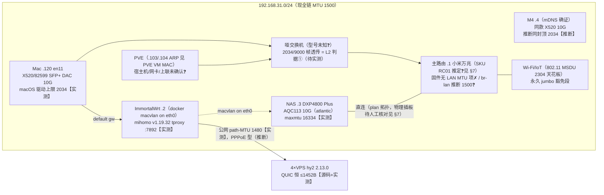

# 内网 Jumbo MTU 与旁路由 VPN 传输效率研究报告

> 研究执行：2026-10-12 ｜ SDD workspace：`.superpowers/sdd/jumbo-mtu-research/`（五份详细报告 + review 记录，git-ignored）
> 证据链约定：本报告所有数字/结论均溯源到五份 task 报告（标注如「Task 1 §1」），task 报告引用 `docs/network/data/` 原始数据文件（56 个）。本文不引入五份报告之外的新事实；所有【推断】标签沿用原报告证据分级。

## TL;DR 结论矩阵

| 方向 | 可行性 | 预期收益 | 一句话依据 |
|---|---|---|---|
| **内网 9000（全域）** | ❌ **不成立** | Apple 端点无法参与，仅剩 NAS↔PVE 子路径的理论可能 | Mac en11 = X520/82599，macOS 驱动 `AppleEthernetIXGBE` MTU 上限 **2034**（实测，Task 1 §1）；同款卡的 M4（.4）推断同样封顶（Task 3 R4）；9000 全档在本栈不成立（Task 3 总体预判） |
| **内网 2034 档**（Mac↔NAS / Mac↔M4） | ⚠️ **可行但未证实**——依赖两项 L2 判据实测（GATE-1） | LAN 吞吐低个位数提升（4 流接收瓶颈形态下可能更高，待实验）；pps ÷1.37、双端包处理开销下降 | 两端网口均支持（Mac 2034 上限 / NAS `maxmtu 16334`，实测）；中间 L2（哑交换机透传 + Mac↔NAS 是否穿主路由 LAN 桥）是唯一未知数（Task 3 矩阵） |
| **VPN（hy2 over QUIC）** | ✅ **零风险但零吞吐收益**——不为 VPN 做任何 MTU 变更（2034 档对跨网 TCP 大包的影响见 §4.3/§8 A3 G2） | 隧道吞吐 ≈0、隧道协议腿 CPU ≈0；唯一理论收益是 LAN 第一腿 MSS 1460→1994 带来的容器 CPU **−2~5%（相对，可信度低）** | QUIC 单包硬上限 1452B 与 underlay MTU 完全解耦（三份 quic-go 源码 + 运行版复验，Task 4 R1/R2；实测 1000 包 0 个 >1452，Task 5 §1.3）；公网 path-MTU 1480 硬边界（Task 2 A6） |
| **低风险优化项**（不动 MTU） | ✅ 立即可做 | 修复既有缺陷 + 核对性能前提 | QUIC buffer 核对（容器 netns）、桌面 mihomo pm2 常驻状态核对、fw4 `mtu_fix` nft 规则未生效修复（Task 2 A4 / Task 4 R7 / Task 5 §1.5） |

**核心判断**：9000 不是本栈的候选档位；2034 档是"可行的实验对象"而非"已证实的收益来源"；VPN 链路与 MTU 无关（实证链），相关动作只剩低成本核对项。是否推进 2034 档实验由 GATE-1 决定（§7）。

---

## 1. 背景与研究方法

### 1.1 研究动机与边界

内网当前全链 MTU 1500。研究问题：启用 jumbo（原目标 9000）能否提升两条链路的效率——(a) 内网大流量（Mac↔NAS、开发机间）；(b) 旁路由 VPN（ImmortalWrt/mihomo → hysteria2 QUIC → 4×VPS）。全程只读授权（SSH NAS/VPS 只读、sops 白名单字段），任何 MTU 变更属独立 gate：GATE-1（本报告研究结果呈现）→ GATE-2（落地方案 approve）→ 低峰窗口执行（plan Context/Global Constraints）。

环境澄清（避免误判，Task 1 §2/§3）：Mac 的 utun7 = Nebula overlay（mtu 1300，承载 k8s API），不承载 `192.168.31.0/24` 业务流量；系统代理此刻 disabled、桌面 mihomo 未运行（pm2 空表）——对 MTU 研究无干扰，但影响 H4 前置（§8）。

### 1.2 物理拓扑（plan 原图 + 实测标注）



关键拓扑语义（Task 1 §2）：

- Mac 的默认网关是旁路由 `.2`，但内网 /24 目标（.1/.3/.4）均为 **host route 直连**（L2，不经 .2 转发）——Mac↔NAS 大文件与 Mac→公网 VPN 是两条完全不同的路径，MTU 影响链分别评估。
- **Mac↔NAS 的物理 L2 路径未确认**（traceroute/ARP 无法区分中间 L2 设备）：按 plan 拓扑 = 哑交换机 + 主路由 LAN 桥两跳。若属实，**主路由 br-lan（默认 1500、固件无设置项）将与哑交换机并列为 2034 档生死判据**（Task 3 R1 条件化推论）；此为 GATE-1 #1 决定性待决项（§7）。
- 旁路由容器是 NAS eth0 上的 macvlan（`.2`），宿主 shim 接口 `macvlan-shim`（`.250`）解决宿主↔容器互通。

### 1.3 研究方法：SDD 5 任务 + review 循环

数据先行原则：4 个数据/调研任务全部只读完成、经 per-task review 修正后，第 5 个任务综合设计基准测试矩阵并执行只读基线。任务分工与 review 闭环情况（ledger 详见 §10.3）：

| # | 任务 | 产出 | review 闭环 |
|---|---|---|---|
| 1 | `mtu-lan`：内网物理拓扑与 MTU 能力矩阵（Mac 本机视角） | 13 数据文件 + report | 1 轮 APPROVED（5 minor deferred） |
| 2 | `mtu-vpn`：旁路由容器与 VPN 数据面收集（NAS/容器/VPS/仓库视角） | 13 数据文件 + report | 1 轮 APPROVED（4 minor deferred） |
| 3 | `mtu-jumbo`：jumbo 技术可行性文献研究（引用级证据） | report（无数据文件） | 1 轮 fix（2 个 I 级 finding）→ APPROVED |
| 4 | `mtu-quic`：hy2/QUIC/mihomo MTU 行为源码研究 | report（无数据文件） | 1 轮 fix（2 个 I 级 finding）→ APPROVED |
| 5 | `mtu-bench`：基准测试矩阵设计 + 只读基线执行 | 30 数据文件 + report | 2 轮 fix → APPROVED（11 findings 全闭环） |

关键 review 修正（已在各 task 报告内体现，本文沿用不回退）：① retransmits 前向=N/A / 反向真值 64/257；② CPU 主口径钉 iperf3 内建 `cpu_utilization_percent`；③ Task 3/4 收益量化重标定为两档制（2034 现实档 / 9000 供他机参考档）；④ M4 同封顶 2034 保持【推断】标签不升格为实证（Task 3 fix round 1 / Task 4 fix round 1）。

### 1.4 数据文件索引（56 个，`docs/network/data/`）

| 组 | 文件（组内列举） | 数量 | 支撑章节 |
|---|---|---|---|
| task-1 本机探测 | ifconfig-a / system-profiler-ethernet / networksetup / utun-owner / scutil-proxy / pm2-list / arp / oui / mdns / router-probe / pathmtu / traceroute / netstat | 13 | §2（设备能力与拓扑）、§3 |
| task-2 容器与 VPN 数据面 | nas-network / nas-nic / docker-network / container-net / uci / mssclamp / tproxy-mode / mihomo-config / desktop-config / vps-all / vps-primary / vps-pathmtu / pathmtu | 13 | §4（VPN 数据面）、§9 |
| task-5 LAN 基线 | lan-single-r1..5 / lan-4p-r1..5 / lan-rev-r1,2 / lan-30s / lan-summary / mac-netstat-en11 / mac-cpu-30s / nas-lan-snapshots | 17 | §3 |
| task-5 VPN 基线 | vpn-curl / vpn-summary / nas-vpn-snapshots / mac-netstat-en11-vpn | 4 | §4 |
| task-5 QUIC/GSO | quic-baseline.pcap / quic-download.pcap / quic-pktlen-hist / gso-burst-evidence / gso-check / gso-vps | 6 | §4 |
| task-5 环境与发现 | mac-env / nas-env / ugos-and-nic-stats | 3 | §3、§8 |

task-3/4 为纯文献/源码研究（引用内嵌于报告正文），无数据文件。

---

## 2. 内网设备能力矩阵与物理拓扑（Task 1 + Task 3）

### 2.1 设备 × 档位能力矩阵

| 设备/组件 | 网卡·链路 | 9000 | 2034 | 证据等级 | 关键备注 |
|---|---|---|---|---|---|
| **Mac .120（en11）** | Intel X520/82599 SFP+ DAC（TB PCIe 转接），协商 10Gbase-Twinax | ✗ 驱动不可 | ✓（即上限） | 【实测】 | `networksetup -listvalidMTURange en11` = **1280–2034**（`docs/network/data/task-1-networksetup.txt`）；驱动级 `max-mtu`，GUI/ifconfig 均无法绕过（Task 3 R4）；DF payload 现实上限 2006 |
| **M4 .4** | 同款 X520（同 OUI `90:e3:ba`，仅一号之差；设备 ID 确证 82599） | ✗（推断） | ✓（推断） | 【推断】 | 无 SSH 授权；若同为 macOS + IXGBE 驱动则同封顶 ~2034（Task 3 R4，Task 1 §6 同判）；待 GATE-1 #3 用户侧验证 |
| **NAS .3** | AQC113 10G（atlantic，fw 1.3.31，已协商 10000Mb/s） | ✓ 硬件 | ✓ | 【实测+文档】 | `maxmtu 16334`（`docs/network/data/task-5-gso-check.txt`）；AQC 系 datasheet 16KB jumbo；UGOS Pro ≥1.0.0.0888 起 GUI 可设 9000（版本待核，GATE-1 #4）；注意个别版本"设后回落 1500"持久化 bug（Task 3 R3） |
| **主路由 .1** | 小米万兆（身份实测为小米；RC01 推定待证） | 固件✗ / 硬件可能 | L2 桥待判 | 【社区共识+推断】 | 官方固件无 LAN MTU/jumbo 设置项（WAN 侧 PPPoE 微调除外）；IPQ9570 平台硬件大概率支持大帧；可控路径=刷 QWRT（不建议为此刷机）（Task 3 R1） |
| **哑交换机** | 型号未知（无管理面板） | 大概率✓ | 大概率✓ | 【同类文档+待实测】 | 现代无管理交换机 9–16K 帧支持是行业标配（TP-Link/D-Link/Zyxel/FS datasheet）；**L2 层面唯一文献盲区**，必须实测（Task 3 R2） |
| **macvlan `macnet` ± shim** | NAS eth0 上的 macvlan（.2 / .250） | 跟随 parent | 同 | 【源码+待实测】 | docker 不支持给 macvlan 显式设 MTU（moby issue/源码）；内核强制 macvlan ≤ parent；parent 抬升后实际值必须重核（当前 1500 环境无法区分继承源）（Task 3 macvlan 节） |
| **ImmortalWrt 容器网络栈** | br-lan + fw4 | 可配 | 可配 | 【文档】 | 正确改法是 `config device` section；br-lan 改 MTU 有锁死管理面先例（GL.iNet 案例），改前必须留 1500 备用通道（Task 3 R5） |
| **Wi-Fi/IoT 设备** | 802.11（含小米 IoT、家电、手机、回音壁） | ✗ | ✗ | 【文档证实】 | 802.11 MSDU 2304 硬限制（mac80211 kernel limitation），永久豁免段；风险在有线→无线跨界（Task 3 R6） |
| Mac en7（USB RTL8153，inactive） | — | ✗（上限 1500） | ✗ | 【实测】 | 当前无链路（Task 1 §1） |

### 2.2 内网设备清单（Task 1 §4，ARP 22 条 + OUI + mDNS）

| IP | OUI/厂商 | 推测类型 | 证据 |
|---|---|---|---|
| .1 | Xiaomi | 主路由（万兆 SKU 待补，GATE-1 #2） | HTTP title；traceroute 第 2 跳 |
| .2 | 本地管理 MAC（`02:42`） | 旁路由容器 ImmortalWrt（macvlan） | Docker 生成惯例；默认网关（实测） |
| .3 | Ugreen | NAS DXP4800 Plus | mDNS `_smb._tcp` 实例 "DXP" |
| **.4** | `90:e3:ba`（与本机 en11 同批 X520） | **M4 主机（Apple 桌面机）** | mDNS `M4.local` → .4 + .32 双地址（Task 1 修正：非 PVE builder） |
| .32 | Apple | M4 的板载网络接口 | M4.local 第二地址 |
| .103 / .104 | Proxmox | PVE 上的 VM（宿主机不明，GATE-1 关联盲区） | PVE 默认 VM MAC 段 |
| .250 | 本地管理 MAC | macvlan-shim（宿主↔容器互通；Task 1 早期猜测已被 Task 2 推翻修正） | `ip -4 addr`（Task 2 A1） |
| .144/.150/.170/.196/.229/.232 等 | Xiaomi / Midea | 小米 IoT 与美的家电（约 8 台） | OUI |
| .225 等无线终端 | Xiaomi / Apple | 手机/笔记本（Wi-Fi，永久 1500 段） | OUI / mDNS |
| .224 / .228 | 随机化 MAC | 疑手机（Wi-Fi random MAC） | locally administered 位 |

另见（未入 ARP 固定地址）：Samsung 回音壁、iPhone（mDNS）——均 Wi-Fi 段，不参与 jumbo 域。utun7 = Nebula overlay（mtu 1300，承载 k8s API，Task 1 §3）不承载内网业务。注：Task 1 早期对 `.250` 的“疑手机”猜测已被 Task 2 的 macvlan-shim 事实推翻修正（ledger deferred F003），本表按最终结论收录。

### 2.3 两项 L2 生死判据与拓扑未确认项

内网 2034 档（乃至任何 >1500 档）能否成立，取决于**两个实测点**（Task 3 移交清单 + Task 5 A1）：

1. **哑交换机的 2034 帧透传能力**——`ping -D -s 2006` 系列 + NAS 侧 `InJumboPackets` 计数器归因（§8 A1 P1）。
2. **Mac↔NAS 物理 L2 路径是否穿行主路由 LAN 桥**——traceroute/ARP 无法分辨，需人工核对网线/DAC 实际插板（GATE-1 #1，决定性问题）。若穿行：主路由 br-lan 默认 1500 且固件无设置项 → **2034 档可能也被封顶**（Task 3 R1 架构级推断）。

诚实标注不确定性：本研究的 ARP/mDNS/traceroute 全部探测均为**逻辑拓扑**证据；物理拓扑（交换机独立性、M4/PVE 上联位置）未做人工确认，是能力矩阵中"哑交换机"与"主路由 LAN 桥"两行无法闭环的原因。

---

## 3. 内网链路基线（Task 5 §1.1，全链 1500，只读）

### 3.1 LAN 吞吐与包速率（Mac .120 → NAS .3，host route 直连）

| 指标 | 单流 ×5 轮 | 4 流 ×5 轮 | 30s 满载窗 |
|---|---|---|---|
| 各轮吞吐 (Gbps) | 6.96 / 6.94 / 7.18 / 6.75 / 6.68 | 6.47 / 5.68 / 5.10 / 5.19 / 6.42 | 5.78 |
| **中位 (Gbps)** | **6.94** | **5.68** | — |
| retransmits | **N/A**（macOS sender 侧 JSON 无此字段，不读不存在字段） | N/A | N/A |
| NAS 整机 busy（/proc 差分参考口径） | 17.4–23.0% | 28.8–34.1% | — |
| NAS busy（iperf 内建 `remote_total` 主口径） | 单流 r1 ≈ 44.6% | ≈ 61.8%（5 轮中位，56.3–68.0） | — |
| Mac en11 出向 pps（收紧配对复算） | 0.53–0.58 Mpps | 0.43–0.52 Mpps | **0.490 Mpps**（in ACK 17.4k） |

反向（NAS 发送，sender=NAS）：**8.13 / 7.96 Gbps**，`sum_sent.retransmits` 真值 **64 / 257**——这是全组唯一的 retransmits 实测口径（Task 5 §1.1 修正后主表）。冒烟 RTT 0.412ms 证直连。NAS 空闲本底 busy 10.1%（141 天 uptime 的常驻负载）。数据：`docs/network/data/task-5-lan-summary.txt` 及 17 个 lan-* 文件。

**基线形态解读**（Task 5 §1.1 发现）：a) **4 流反而低于单流**且 NAS busy 更高——NAS 接收路径（软中断/驱动）是 1500 档的多流瓶颈候选，恰是 jumbo 要解决的形态（H3 判读素材）；b) Mac 发送 6.9G vs NAS 发送 8.0G，不对称 ~15%；c) 490k pps @ 5.78Gbps ≈ 1477B/帧，与 MTU 1500 自洽——**2034 档同吞吐预期锚点 ÷1.37 ≈ 358k pps**（未来 on/off 对照的硬判据）。

### 3.2 包计数本底（B6，供未来 on/off 对比，`docs/network/data/task-5-vpn-summary.txt`）

| 场景 | 窗口 | Mac en11 | 说明 |
|---|---|---|---|
| LAN 满载（Mac→NAS 5.78Gbps，MTU 1500） | 30s | **out 490,238 pps / in(ACK) 17,372 pps** | ≈1477B/帧；2034 档预期同吞吐 ÷1.37 ≈ 358k pps |
| VPN 满载（下载 ~130Mbps，4 个有效 30s 中窗） | 4×30s | **in 11.7–12.8k pps / out(ACK) 0.97–1.3k pps** | 第一腿 MSS 1460；即 H3 的 pps 判据基线（2034 档预期 in ≈ 9.0k pps @ 同吞吐） |
| NAS eth0（PROMISC，计数含非 NAS MAC 的环境帧） | 各轮 | 满载 13.6–15.5kpps | 口径注意：Mac↔.2 流量亦被计入 |

### 3.3 CPU 采样口径规范（GATE 后所有实验的主尺，Task 5 §1.1.1）

实测发现两套口径在同窗内方向相反、幅度均近 **2×**（Mac：top 32.6% vs 内建 16.5%；NAS 单流：/proc 差分 23.0% vs 内建 remote 44.6%）——系统计目标与采样窗的语义差异，**各自内部自洽、互相不可换算、禁止混排**。钉死规范：

1. **LAN iperf3 轮：`cpu_utilization_percent`（host=Mac、remote=NAS）为唯一主口径**（与吞吐同窗同 JSON 自动产出）。
2. 参考口径（仅异常时同窗复核，不参与判读）：Mac `top -l 2 -s 8` 第二样本；NAS `/proc/stat` 首行差分。
3. **VPN/mihomo 腿：`/proc/<pid>/stat` utime+stime 差分为唯一主口径**，pid 须窗口内 `pgrep -fx` 动态解析（nikki 会重载），**每实验窗配同长 idle 参照窗扣背景**。
4. on/off 只做同口径相对比较；出现 ~2× 矛盾先用参考口径回核同窗。

---

## 4. VPN 数据面与 QUIC 行为（Task 2 + Task 4）

### 4.1 数据面事实（Task 2）

- **公网 path-MTU = 1480**（PPPoE 型）：NAS → 两台 VPS 均 1452 payload ✅ / 1453 ❌（内核回 `local error: message too long, mtu=1480`）；Mac 侧公网对照同值且表现为 DF 黑洞（1453+ 无 ICMP 回应，多次复测稳定）。8972 档失败——**内网 jumbo 无法穿透 PPPoE 出网，硬边界**（Task 2 A6）。
- NAS 与容器全接口 1500（macnet 无显式 MTU 配置，继承默认）；mihomo **tproxy :7892**（TCP+UDP，nft 链活跃，计数 232 万包），**容器内无 tun 接口**，config 中 `tun.enable: true` 被 nikki 运行时覆盖未生效——无 tun 封装开销变量。运行二进制 **mihomo v1.19.32**（with_gvisor）。
- hy2 服务端 ×4 一致：v2.13.0、listening `:20000-30000` port hopping、`udpIdleTimeout: 90s`、`ignoreClientBandwidth: true`、**QUIC 高级参数全部默认**（Stream/Conn 窗口 8/20MB、maxIdleTimeout 30s、DPLPMTUD 开启）；VPS 出口接口 1500；sysctl rmem/wmem 64MB（`docs/network/data/task-2-vps-all.txt`）。

**出网 path-MTU 实测表**（NAS 本体，容器 BusyBox ping 无 `-M do` 的等效替代；`docs/network/data/task-2-pathmtu.txt`）：

| ICMP payload | 总 IP 包 | → vpn_primary (45.202.255.241) | → vpn_premium (103.112.1.197) |
|---|---|---|---|
| 1400 | 1428 | ✅ 100% | ✅ 100% |
| 1452 | 1480 | ✅ 100% | ✅ 100% |
| **1453** | **1481** | ❌ `local error: message too long, mtu=1480` | ❌ 同左 |
| 8972 | 9000 | ❌ | ❌ |

**hy2 服务端 QUIC 相关配置表**（4 台一致；默认值源码/官方文档，task-2 C3）：

| 字段 | 显式配置 | 未显式时的官方默认 |
|---|---|---|
| listen | `:20000-30000`（port hopping 池） | — |
| udpIdleTimeout | 90s | 60s |
| ignoreClientBandwidth | true（服务端不采纳客户端带宽上报） | false |
| quic.initStreamReceiveWindow / maxStreamReceiveWindow | 未配置 | 8388608（8MB） |
| quic.initConnReceiveWindow / maxConnReceiveWindow | 未配置 | 20971520（20MB） |
| quic.maxIdleTimeout | 未配置 | 30s |
| quic.disablePathMTUDiscovery | 未配置 | false（DPLPMTUD 开启，自动在 1480 路径收敛） |

其余服务端事实：sysctl 64MB ≫ QUIC 默认窗口 8/20MB，**无缓冲区瓶颈**；4 台均无 UDP 443 监听（入口即 hopping 池，与 defaults 注释存在记录性偏差，不影响 MTU 结论）；VPS→家反方向 ICMP 全丢弃（入站全无响应，无法直接测反向 PMTU，Task 2 缺口 2）。

### 4.2 QUIC 行为（Task 4，源码实证 + Task 5 实测复核）

- **单包硬上限 1452B 与 underlay MTU 完全解耦**：quic-go `MaxPacketBufferSize = 1452` 写死（以太网预算），三个实际运行的实现（apernet fork、metacubex fork、upstream）逐行一致；运行版 v1.19.32 的依赖钉版（`2548683b76f4`）已独立复验不改。quic-go **不读网卡/路由 MTU**；GSO 分段尺寸 = 当前包大小（≤1452），不是接口 MTU。"9000 MTU 接口上会不会自动用大包"的答案是**否**。
- **DPLPMTUD（RFC 8899）**：二分搜索，起点 1250（Chrome parrot 指纹）/1280，每 5×RTT 一个 PING probe，探测上限 = min(对端 `max_udp_payload_size`, **1452**)，每生命周期 <10 个 probe；port hopping 走 `DisablePathManager` 不重置搜索。
- **实证**：满载窗 1000 包样本（VPS 侧 pcap ×2），隧道腿 UDP payload **众数 1443B、0 个 >1452**——与源码断言完全吻合（1452 上限 − quic-go 在 1480 path 的收敛）。baseline 窗 84.6% 为 1443B（`docs/network/data/task-5-quic-pktlen-hist.txt`）。
- **GSO/GRO 抵消因素**：发送侧 UDP GSO 默认开（一次 syscall ≤20KB 批 ≈ 14×1452B 包，Cloudflare 实测 syscall 904,539→18,824，≈48× 摊薄）；接收侧无 UDP GRO（recvmmsg 8/批）。三处 ethtool `tx-checksumming on`（NAS eth0 / 容器 macvlan / VPS ens3）实测满足 GSO 前提；满载 pcap 下行 gap 双模（<50µs 簇内 + 1–5ms 簇间）与 GSO 形貌一致——**该形貌证据属 VPS 发送腿，mihomo 腿运行时确认待负对照**（Task 5 §1.4 腿归属判读）。
- **mihomo tproxy = 纯用户态 relay**（`net.TCPListener` + `IP_TRANSPARENT`，`LocalAddr()` 取原始目标，无任何 MSS setsockopt）：underlay MTU 实际影响的只有两处——(a) **Mac↔mihomo LAN TCP 第一腿的 MSS**（内核按路径 MTU 协商）；(b) 无。mihomo↔VPS 包大小被 QUIC 1452 锁死。hy2 UDP relay 载荷上限 1197（`udp-mtu` 默认）。

### 4.3 现状缺陷：tproxy MSS clamp 未生效 + 黑洞敞口

| 位置 | 事实 |
|---|---|
| fw4 UCI | 容器 wan zone `mtu_fix='1'` 已配置 ✔ |
| 实际规则 | nft ruleset 3994 行中 **mss/mtu 规则 0 条** ✘——旁路由拓扑中 wan zone 无绑定接口，fw4 不为空 zone 生成 TCPMSS clamp（`docs/network/data/task-2-mssclamp.txt`） |
| 含义 | **当前全网无任何 MSS clamp**；公网 1480 路径实测为 DF 黑洞（无 ICMP 回执）——内网抬 MTU 后，跨网 TCP 大包仅靠各端自身 PMTUD 兜底；quic-go/QUIC 侧有 DPLPMTUD 兜底不受影响 |
| 附注 | MSS clamp 本就只救 TCP；且 fw4 文档默认也仅对 wan zone 出向流量生效（Task 3 R5） |

此缺陷独立于本研究存在（现网 1500 下公网 1480 黑洞同样敞口），修复建议见 §9。

### 4.4 VPN 基线与瓶颈定位（Task 5 §1.2）

| 指标 | gw（tproxy 缺省路径） | proxy（显式 mixed :7890） |
|---|---|---|
| 稳态中位吞吐（55s × 1GB, OVH 源） | **130.8 Mbps** | **131.0 Mbps**（双路径等价，差 0.2% < 波动带 ±5–9%） |
| mihomo 进程 CPU（满载） | 单核 ≈ **21%**（21.2/19.1/20.4/22.5 ticks/s，NAS 6 核 → 整机 ~3.5%） | 同量级 |
| NAS 整机 busy（/proc 参考） | 8.4–11.9%，增量 ≤2%（噪声级，本底 10.1%） | 同 |

出口对照：两路径出口同为 `103.112.1.197 (colo=NRT)`——同一 mihomo 数据面、同一节点。**隧道瓶颈不在 NAS/mihomo CPU，应在公网路径**（与"隧道腿收益 ≈0"的机理预测互证）。背景噪声披露：mihomo 背景 ticks 7–37/s 与满载 21% 同量级——on/off 微差判读必须配 idle 参照窗（Task 5 §1.2，A4 规范据此）。

**VPN 零收益实证链**（多源互证）：① 源码——QUIC 不发 >1452 包、不读接口 MTU、GSO 段大小不变；② 实测——1000 包 0 个 >1452、众数 1443（= 1480 path 收敛值），`disablePathMTUDiscovery: false` 默认开即自动收敛；③ 路径——公网 1480 丟大包（1453+ 无 ICMP），9000 无法出网（Task 2 A6）；④ 基线——瓶颈在公网不在 CPU（§4.4）。结论：**任何内网 MTU 档位都无法提升 hy2 隧道吞吐，且因 QUIC 从不发 >1500 的 IP 包，也不产生新增黑洞风险**（Task 4 R3）。

---

## 5. 可行性结论（决策标准执行）

对照 plan「决策标准」逐条执行：

### 5.1 内网

- **9000 全域：不成立。** 判据链：Mac en11 驱动上限 2034（实测）＞ M4 .4 同款 X520 推断同封顶（Task 3 R4）→ Apple 端点无法参与任何 >2034 档位。9000 档仅"NAS ↔ PVE/未来 AQC 端点"子路径**可能**成立（NAS 硬件已证，PVE 网卡未知、无数据），且小米路由器固件不提供 9000 入口（刷机不建议为此单独承担）。按决策标准：**存在硬件短板 → "当前不可行" + 替代方案评估**——替代档位即 2034。
- **2034 档：可行但依赖两项 L2 判据实测**（§2.3）。Mac↔NAS、Mac↔M4（两台 X520 同款硅，最小跳数）在该档位可行性较高；三个实测点决定成败——哑交换机帧转发（bench 1）、Mac↔NAS 是否穿主路由 LAN 桥（bench 8）、macvlan 容器跟随值（bench 4）。**在判据落定前，"可行"是推断而非实锤。**
- **收益预期（两档量化，Task 4 R8 / Task 3 R7）**：
  - 现实档 2034：单帧负载 ÷1.37（包数 −26%），MSS 1460→1994；吞吐百分比级收益预期**低个位数**（现代 TSO/GRO/中断合并已摊薄每包成本）——但基线发现 4 流时 NAS 接收侧成瓶颈（busy↑ 吞吐↓，§3.1），该形态下包处理开销下降可能有超比例改善，**幅度必须由 GATE 后 A/B 实测定标**；pps 锚点 490k→~358k；mihomo 容器 CPU 预期 −2~5%（相对，可信度评估见 §5.2），NAS 接收路径幅度无先验、以 4 流瓶颈形态为主要观测意义。
  - 全幅档 9000（本机不可达，供未来换 AQC 系网卡/其它主机参考）：MSS 8960（÷6.1），容器 CPU 预期 −5~15%。
- Synology"jumbo 翻倍"案例源于弱 CPU NAS，对 8505/X520 组合**不具可迁移性**（Task 3 R7）。

**两档量化总表**（Task 4 R8/收益预判；jumbo off = 现状 1500）：

| 档位 | MSS | 包数 / syscall 变化 | 预期收益 | 适用对象 |
|---|---|---|---|---|
| 现状 1500 | 1460 | — | — | 全体（基线） |
| **2034 现实档**（ Mac en11 驱动上限） | 1994（÷1.37） | relay read/write 与 memcpy ÷1.37（↓~27%)；en11 中断 ÷~1.4 | 吞吐持平或低个位数（4 流形态待测）；mihomo 容器 CPU −2~5%（相对，§5.2 可信度评估） | Mac(≤2034)↔mihomo LAN TCP 第一腿、Mac↔NAS/M4 |
| 9000 全幅档（本机不可达） | 8960（÷6.1） | ÷6.1 | 容器 CPU −5~15%；包数 ÷6.2 | 其它支持 jumbo 的主机（PVE/AQC 系网卡） |

### 5.2 VPN

- **吞吐：实证零收益**（§4.4 实证链）——满足决策标准中"提升 <5% → 不值得"分支，**不进任何 MTU 变更**；
- **CPU：2034 档 mihomo 容器预期 −2~5%（相对量）的诚实可信度评估**：机理方向可靠（用户态 relay 的 read/write syscall ÷1.37，源码级事实），但**幅度是推断值未经定标**，且存在三重削弱因素——① 它是相对量：单核 21% 的 2–5% 相对 ≈ 0.4–1.05 个百分点单核，整机（6 核）<0.2pp，无运维可感知性；② 背景 ticks 7–37/s 与预期微差同量级（§4.4），不做同窗 idle 参照即被淹没；③ 该收益仅在 VPN 满载 + Mac↔mihomo TCP 腿全程 2034 时兑现（tproxy 拦截的是 LAN TCP 第一腿，若 Mac 只提 en11 而容器 macvlan 未跟随即吃不到）。**结论：方向可信、幅度不可信、价值不足——按决策标准"CPU 显著下降"分支未达标，不进 Task 6a 配置项**，仅保留 §9 低成本项。

---

## 6. 用户四大场景收益评估

### 6.1 Mac ↔ NAS 大文件（SMB/直连）

- **现状**：单流 6.94G / 反向 8.0G（§3.1），均已处较高水位；4 流 5.68G 且 NAS 接收 busy 偏高——**这是 jumbo 最对症的形态**。
- **2034 档成立时**：吞吐低个位数提升（单流 6.94G / 反向 8.0G 已处较高水位，增量幅度待实验；4 流/接收受限场景可能更明显——基线瓶颈形态正是其观测窗口）；长时间大文件拷贝下双端包处理开销有小幅下降。
- **前提**：两项 L2 判据（§2.3）+ UGOS 版本核对（GATE-1 #4）。谁受益：受益者是 NAS 接收路径软中断负载与时延抖动，人感知有限。

### 6.2 VPN 出口流量（Mac → 公网下载/上传）

- **隧道腿零收益**（实证链，§4.4）：吞吐维持 ~131Mbps（瓶颈公网），QUIC 包恒 ≤1452。
- 唯一变化：LAN 第一腿 MSS 1460→1994 → mihomo CPU −2~5%（相对，可信度见 §5.2）——用户侧无感知，纯粹是 NAS 侧微省电。
- **结论：VPN 使用体验与内网 MTU 决策完全正交。**

### 6.3 内网开发机（M4、PVE）

- **Mac ↔ M4**：两台 X520 + DAC 同款硅、最小跳数，是 2034 档候选实验链路（Task 1 §7）；但 M4 侧能力**未经实测**（推断同 2034 封顶，无 SSH 授权）——需要用户在 M4 上执行 `networksetup -listvalidMTURange`（GATE-1 #3）才可纳入 jumbo 域。若成立，收益形态同 6.1（开发机间流量以大块编译产物/同步为主，方向同）。
- **PVE（.103/.104 为其 VM，宿主机不明）**：物理网卡与上联路径均为盲区，无任何能力数据；仅有的结论是"NAS↔PVE 的 9000 子路径**可能**成立"（Task 3 总体预判，前提 PVE 网卡支持）。**诚实结论：场景无数据，评估不可得，需先补探测。**
- PVE 经哑交换机上联（plan 侦察事实，未复核）——与 Mac 同路径，哑交换机判据对两者一票否决。

### 6.4 备份同步

该场景本身不引入独立受益面——按流量路径映射，落到前两档结论：走 Mac↔NAS 链路的备份（大块顺序 IO）→ 同 6.1（2034 档低个位数，夜间批量任务对时延不敏感，收益意义进一步缩水）；走公网/VPN 的同步 → 同 6.2 零吞吐收益；NAS 常驻后台任务（qb/frp 等，构成 10.1% 本底 busy）与备份叠加时，包开销下降对 NAS busy 仅有 H3 同款的小幅机理贡献。**结论：不值得为备份场景单独驱动 MTU 变更，收益随附于 6.1。**

---

## 7. GATE-1 待决问题（向用户提问清单）

> **决定性问题（先问这个）：Mac ↔ NAS 的物理 L2 路径人工确认**——网线/DAC 实际插在哪个设备上？仅经哑交换机（若 NAS 也挂哑交换机/存在独立万兆交换机），还是穿越主路由 LAN 口？traceroute/ARP 无法分辨，必须人工核对插板。若穿行主路由 LAN 桥（默认 1500、固件无设置项），**Mac↔NAS 的 2034 档大概率被封顶，整个内网 2034 方案即降级为 Mac↔M4 局部档**（Task 3 R1）。

| # | 缺口 | 影响的实验 | 建议补齐方式 |
|---|---|---|---|
| 1 | **Mac↔NAS 物理 L2 路径**（即上述决定性问题） | A1 判据链 | 用户人工核对网线/DAC 插板 |
| 2 | 主路由 SKU 具体型号（小米万兆 BE10000/RC01 为推定） | LAN 2034 理论边界核对 | 用户口述 / 米家 App / 授权后台 |
| 3 | `.4`（M4，同款 X520）MTU 上限与可达授权 | Mac↔M4 链路加入 jumbo 域 | 用户在 M4 上执行 `networksetup -listvalidMTURange` 或授权 SSH |
| 4 | UGOS Pro 版本号（≥1.0.0.0888 才有 GUI 9000；CLI 不可见） | 落地期 GUI 路径（实验用 CLI 不受阻） | 用户读 UI 关于页 |
| 5 | VPN 出口 ~130Mbps 的归属（VPS 线路 / PPPoE / 移动侧） | 基线解读（H1 瓶颈定位） | GATE 后可选：VPS 侧 iperf3 server（需授权）或换 VPS 对照 |
| 6 | 背景隧道流量归因（~2Mbps：qb 容器/其他设备） | 基线纯净度 | GATE 后可选暂停窗口重测，或按现状接受（推荐后者，含噪基线更贴近真实收益） |

（第 1–4 项为用户可直接回答；第 5–6 项标注为 GATE 后可选，不阻塞决策。）

---

## 8. GATE 后实验设计摘要（task-5-report A 部分协议浓缩版）

共同前置：实验档位**固定 2034**（9000 全档在本栈不成立）；用户在场 + 低峰窗口 + 本基线做对照 + 每步带回滚。四组协议：

**A1：LAN jumbo 2034 实验协议**——P0 前置（拓扑确认 / 备用管理通道：Mac Wi-Fi 或 en7 + NAS 侧 shim `.250` SSH 保持打开 / 基线重放 ±8% 噪声带内 / 快照留存含 `InJumboPackets` 零值）。

P1 探测序列（判中间链路，归因靠计数器，判据先行）：

| 步 | 动作 | 判读 |
|---|---|---|
| P1.1 | Mac：`sudo /sbin/ifconfig en11 mtu 2034`（**临时性**，重启/重插即回滚，不写配置描述文件） | `ifconfig` 复核；ping .1/.2/.3 通；网页能开 |
| P1.2 | Mac：`/sbin/ping -D -s 2006 -c 10 192.168.31.3`，同步 NAS 前后取 `ethtool -S eth0 | awk '/InJumboPackets/…'` | **ΣInJumbo 增量 = 发包数 → 哑交换机±主路由桥透传成功**；增量 0 → 中间丢弃（2034 不可行，跳 P4 回滚，**无需动 NAS 即完成归因**） |
| P1.3 | 同法对 `.2`/`.4`（若 M4 侧同设） | 各路径判定；`.2` 若要 2006 通过须容器 eth0 已在 2034 |
| P1.4 | 阴性对照：`ping -D -s 1472` 期间 ΣInJumbo 应仍为 0 | 防 InJumbo 计数阈值异常（阳/阴对照法） |

P2 变更序列（每步：改动 → 验证 → 观察 60s → 回归清单）：

| 步 | 变更 | 回滚 |
|---|---|---|
| P2.1 | Mac en11 → 2034 | `ifconfig en11 mtu 1500` |
| P2.2 | NAS `ip link set eth0 mtu 2034`（升 MTU 不杀既有 SSH 连接，已先行验证） | `ip link set eth0 mtu 1500` |
| P2.3 | 核对链（只读）：容器 eth0/br-lan、shim 实际值——**预期不自动跟随**，这是 macvlan 跟随机制文档结论的落地验证点 | 只读无回滚 |
| P2.4 | 容器 eth0 + shim → 2034 | 容器内复位 / `docker restart immortalwrt` 兜底（镜像默认全 1500） |
| P2.5 | 容器 br-lan → 2034（**最高风险步**，GL.iNet 锁死先例；备用通道先行确认） | `ip link set br-lan mtu 1500` / `docker restart` 终极回滚 |
| P2.6 | 双向 DF 复验（Mac↔NAS、Mac↔.2）+ ΣInJumbo 对账 | 100% 回包 |

P3 A/B 对照全套基线重放（**判读锚点**：吞吐持平≠下降、pps 490k→~360k、iperf 内建 `remote` 主口径较 44.6%/61.8% 基线相对下降即 H3 方向成立）；P4 逆序回滚 + 终验（Wi-Fi 设备回归清单 + 终止条件：任何设备失联 >60s、mihomo crash、吞吐劣化 >30% 即触发全量回滚）。

**A2～A4：**
- **A2：GSO 负对照（H6 后半/H7/H8）**——推荐临时第二容器实例 `.251` 注入 `QUIC_GO_DISABLE_GSO=1`（不动生产 `.2`，预检 ARP 无冲突后同参复制镜像），与 `.2:7890` 交错各 3×55s 对比；**含上行 workload 补步**（env 只作用于 mihomo 发送出口，下载场景出向以小帧为主，需 `curl -T` 上行大文件补覆盖）；off 侧吞吐降或 CPU 升即证 GSO 是效率支柱、MTU 不是；若 env 无差异标记 fork 路径未生效，转 pcap 时间戳形态法（off 期下行 gap 应从双模退化为单簇）。
- **A3：混合 MTU 黑洞验证**——G1 有线(2034)↔Wi-Fi 跨界 DF 探测；G2 有线→公网 2006 DF（首跳 `.2` 应产 ICMP need-frag，静默黑即 DF 黑洞坐实——**这是 jumbo 是否伤公网的决定性测试**）；G3 TCP 软启动/挂起观察（MSS clamp 缺失敞口，§4.3）。
- **A4：采样规范**——§3.3 CPU 口径 + mihomo pid 动态解析 + idle 参照窗 + pps 收紧配对规则 + 噪声带（LAN ±8% / VPN ±9%）+ 形态证据标注腿归属 + 临时进程核验输出落档。

**H1–H8 判读表**（只读部分已判，其余待 GATE，task-5-report §三）：

| # | 假设 | 只读判读 | 判据要点 |
|---|---|---|---|
| H1 | jumbo 前后 hy2 吞吐不变 | 基线就绪（130.8/131.0） | \|Δ\| ≤ 3% |
| H2 | 隧道协议腿 CPU 不变 | 锚点就绪（21% 单核） | on/off 分层 ≈ 0 |
| H3 | LAN 第一腿容器 CPU 降 2–5%（2034 档） | 本底就绪 + 瓶颈形态确认 | 主口径相对降幅；pps 12.4k→9.0k |
| H4 | Mac 系统代理路径 \|Δ\|≈0 | 前置不成立（桌面 mihomo 未运行）；替代证据：双路径等价 0.2% | GATE 后拉起桌面 mihomo 补对照 |
| H5 | QUIC 众数两档均 ~1452 | **前半通过**：众数 1443、>1452 = 0 | jumbo 后复拍仍 1443 |
| H6 | GSO 实际生效 | **前半通过**：ethtool 三处 on + VPS 发送腿双模 gap | mihomo 腿待 A2 负对照 |
| H7 | 禁 GSO 显著劣化 | 设计就绪 | off 侧吞吐降/CPU 升 |
| H8 | fork 保留 env 生效路径 | 只读不可验 | 与 H7 合并；无效转 pcap 形态法 |

---

## 9. 低成本无风险优化项清单（不动 MTU 即可做）

以下三项均**独立于本研究的既有问题**，不依赖 GATE 决策，可与实验解耦先行：

1. **QUIC buffer 核对（容器 netns）**：quic-go 启动时尝试 `SO_RCVBUFFORCE`（特权容器一般可），失败则受 netns 上限钳制。核对容器内 `sysctl net.core.rmem_max` ≥ 7MB（docker 容器内该 sysctl 是否独立于宿主 netns 需实测一次，quic-go issue #3801 有先例）；服务端 4×VPS 已 64MB 无需动作（Task 4 R7-6 / Task 2 C2）。
2. **桌面 mihomo 常驻状态核对**：背景描述为 pm2 管理常驻，但两个时点实测均未运行（pm2 空表、系统代理 disabled，Task 1 §2 / Task 5 §1.5）——若预期是常驻，核对 pm2 配置/开机自启；它同时是 GATE 后 H4 对照实验的前置（Task 4 R7-10 / H4）。darwin 侧可选 `kern.ipc.maxsockbuf` 提到 7MB（quic-go docs 建议，Task 4 R7-10）。
3. **fw4 `mtu_fix` nft 未生效修复**：现状为"配置存在、规则 0 条"（wan zone 无接口，§4.3）。基于报告证据的建议（实施前自行验证）：使 fw4 对出网 TCP 生成 TCPMSS clamp，可考虑在 lan zone 出向启用 `mtu_fix`（语义上覆盖 lan→出向转发，OpenWrt 文档级能力，Task 3 R5）或手写 nft TCPMSS 规则；收益是给跨 1480 公网路径的 DF 大包 TCP 提供黑洞兜底（现网 1500 下同样受益）。注意它只救 TCP，QUIC/UDP 仍靠 DPLPMTUD。
4. 附注（防误调优）：hy2 `bandwidth up/down`（Brutal）在当前栈**不可用**——服务端 `ignoreClientBandwidth: true` 且 mihomo 出站强制 BBR（源码级确认，Task 4 R7-4）；设了也不参与拥塞控制，误设过高反而是官方明示的反模式。`experiment.udp-gso`（yaml）是 mihomo UDP relay 开关，与 QUIC GSO 无关（QUIC GSO 唯一关闭路径是 `QUIC_GO_DISABLE_GSO` env）。

---

## 10. 附录

### 10.1 五份详细报告与数据文件的对应关系

五份详细报告 + review/fix 记录位于 SDD workspace（git-ignored，主工作区本地保留）：

| 报告 | workspace 路径（相对仓库根） | 对应数据（`docs/network/data/`，随本报告入 git） |
|---|---|---|
| Task 1 内网拓扑与能力矩阵 | `.superpowers/sdd/jumbo-mtu-research/task-1-report.md`（+ task-1-review.md） | task-1-*（13 个） |
| Task 2 容器与 VPN 数据面 | `.superpowers/sdd/jumbo-mtu-research/task-2-report.md`（+ task-2-review.md） | task-2-*（13 个） |
| Task 3 jumbo 技术可行性（文献） | `.superpowers/sdd/jumbo-mtu-research/task-3-report.md`（+ review + rereview） | 无（引用内嵌） |
| Task 4 hy2/QUIC/mihomo 源码研究 | `.superpowers/sdd/jumbo-mtu-research/task-4-report.md`（+ review + rereview） | 无（引用内嵌） |
| Task 5 基准设计与只读基线 | `.superpowers/sdd/jumbo-mtu-research/task-5-report.md`（+ review + rereview ×2） | task-5-*（30 个） |

workspace 另含 `progress.md`（ledger）、`data/`（与 `docs/network/data/` 同源，56 个）、各 task-brief.md。**PR 合并后**：56 个数据文件与 ledger 随分支进入 git；五份详细报告因 `.superpowers/` 被 ignore 不随 PR 流转——本报告 §1.4/§10.1 的映射表 + 各节「Task N §x」标注即为 PR 内数据 ↔ 详细结论的检索入口；如需永久保留详细报告副本，应另行归档（超出本研究范围）。

### 10.2 复现命令索引（核心项；全量见各 task 报告附录）

```bash
# 能力与拓扑（Task 1 附录 A）
networksetup -listvalidMTURange en11                      # → 1280-2034（驱动硬上限）
/sbin/ping -D -s 1472 -c 3 192.168.31.3                    # DF 探测（>1472 需先提本机 MTU）
# 容器/VPN 数据面（Task 2 附录）
ssh root@192.168.31.3 'docker exec immortalwrt nft list ruleset | grep -ciE "mss|mtu"'   # → 0（clamp 未生效）
ssh root@192.168.31.3 'ping -M do -s 1452/1453 45.202.255.241'                            # 公网 PMTU 1480
# LAN/VPN 基线（Task 5 附录 A；round 窗配对规则与 mihomo pgrep 动态解析见该附录钉死条款）
iperf3 -c 192.168.31.3 -t 10 -J                           # 单/4 流×5 取中位；-R 反向（retransmits 真值在反向）
curl -s -m 55 -o /dev/null -w '%{speed_download}\n' https://proof.ovh.net/files/1Gb.dat # VPN 双路径同法（-x 变体）
# QUIC/GSO（Task 5 B3/B4；VPS 侧）
ssh root@103.112.1.197 'timeout 70 tcpdump -i ens3 -c 500 -w /tmp/q.pcap "udp portrange 20000-30000"'  # 众数 1443
ssh root@192.168.31.3 'ethtool -S eth0 | awk "/InJumboPackets/{s+=$2} END{print s}"'     # GATE 后 2034 归因计数器
```

注意（工具坑，Task 1/5 实录）：Mac 的 PATH 首 nix GNU ifconfig/ping 与系统版本行为不同，须用 `/sbin/ifconfig`、`/sbin/ping`；容器 BusyBox ping 无 `-M do`；NAS 无 tcpdump（抓包 vantage 用 VPS 侧等价替代）；`speed.cloudflare.com/__down` 大文件被拒（改 OVH 源）。

### 10.3 研究过程 ledger 摘要（progress.md）

- **流程**：SDD 子代理驱动，全部数据采集与探测只读授权；Task 1/2 并行（不同数据源）→ 3/4 并行（文献/源码）→ 5 依赖 1–4；每 task 经 reviewer 专项审查 + fix loop 后关闭。Task 1 首次 dispatch 因 provider 网络故障（连接错误）无产出，原配置 respawn 一次成功。
- **review 要点**：Task 3 两个 I 级 finding（TB 适配器 9000 表述与本机 X520/2034 实测冲突；"不依赖路由器"拓扑前提错误——修正为"LAN 桥在路径上待确认 + 移交清单补物理确认项），Task 4 两个 I 级（收益未吸收 2034 硬上限高估 ~4×；证据版本 v1.19.27 vs 运行版 v1.19.32 一致性注记），Task 5 三个 I 级（retransmits 0 无据→N/A+反向真值；CPU 口径 2× 差异→钉主口径；GSO 腿归属+上行补步）——全部在 fix 轮闭环并已体现在本报告。
- **保留的 minor/观察项**（不阻塞结论）：Task 1 deferred ×5（证据等级措辞、Slot 3 映射未落盘、`.250` 早期猜测已被 Task 2 推翻、一处 typo、mDNS 设备名 PII 不入正式报告）；Task 2 deferred ×4（premium NAT 表述不全、ansible 变量名转述、mssclamp.txt 占位注释、桌面 mihomo 版本未实测）；Task 5 观察：iperf `remote_total` 轮间 ±6pp 散布 → 判读必须 5 轮中位对中位；数据文件一处段落标签笔误已按原始记录保留并注记（`docs/network/data/task-5-gso-check.txt`）。
- **现场发现（运维侧，未处理）**：vpn_premium 存在 2026-09-12 起的陈旧 hysteria 2.7.1 进程（不持 `:20000`，活跃 server 为 systemd v2.13.0）建议清理；NAS 上 frpc 容器有周期性 crash-loop 迹象（构成 VPN 基线背景噪声的一部分）。

---

*本报告为研究阶段（Task 1–5）合成稿；后续 GATE-1 决议、GATE 后实验数据与（若可行）Task 6a/6b 落地方案按 plan Steps 6–10 追加。*
