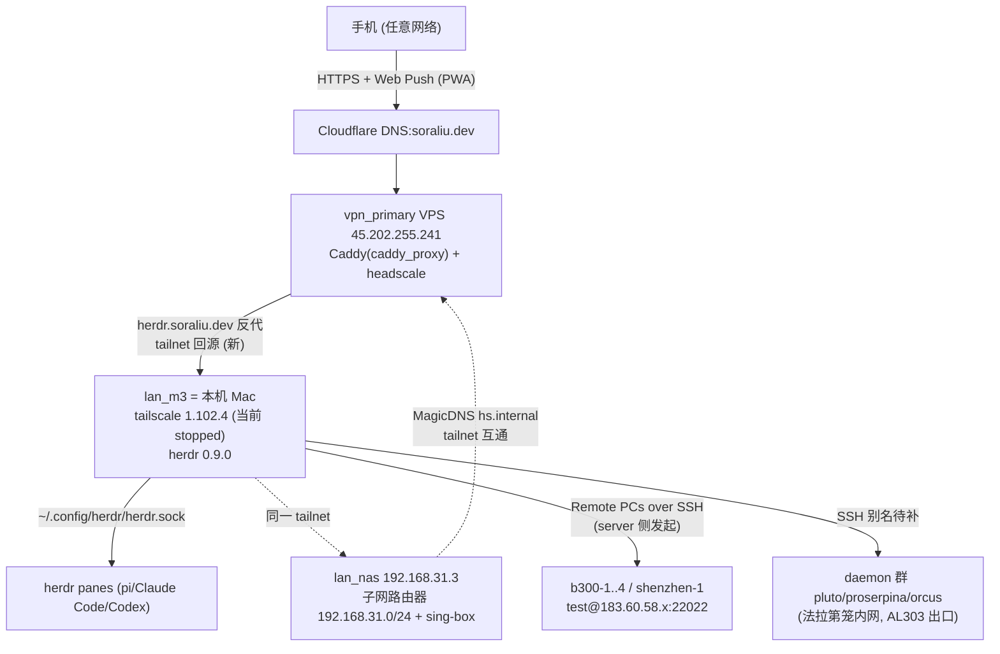

# herdr-web-ui 部署计划（结合家庭网络拓扑）

## Context

上一轮「herdr 通知优化插件」调研结论：通知类插件（focus-notify / terminal-notifier 等）只解决「提示」，而 **devswha/herdr-web-ui**（⭐832，MIT）同时解决「从手机/浏览器直接看到 agent 提问并确认」——chat 视图读 pi / Claude Code / Codex 的 session store，blocked 时 web push 推到手机，确认卡片点击即答。本计划把它装进现有基础设施并打通手机全场景访问。

**网络拓扑现状**（来自 `personal-k3s-ops` inventory 与本机会话，已核实）：



**本机前置核对**（已完成，全部满足）：herdr 0.9.0 ✓ ｜ bun 1.4.2 ✓ ｜ node 22.23.2 ✓ ｜ 端口 7317 空闲 ✓ ｜ nixfiles 已有 herdr 模块 `home/modules/ide/herdr/`（键位 nix 化，插件层留给 herdr 原生管理）✓

## Approach

### 关键决策

1. **安装方式：纯 `herdr plugin install`**，不用官方 `curl install.sh`——脚本会自作主张装 herdr/bun/node 并可能写 shell rc，nix 环境保持零污染（bun/node 已由 nix 提供）。
2. **仓库职责分离**：本机环境（插件安装、env、token）全部在 ~/.nixfiles 声明化管理；网络拓扑配置（Caddy 回源、DNS）写入 personal-k3s-ops。
3. **token 用 sops 加密放 nixfiles/secrets**：仅 token 一个值进 sops，其余 env 行（HOST/PORT/APP_NAME）nix 明文可见——配置可读性与密钥安全各得其所。
4. **手机接入走 Caddy 公网域名**（`herdr.soraliu.dev` → tailnet 回源），复用 `alist.soraliu.dev → lan_nas:5444` 的既有生产模式。**不走 `tailscale serve --https`**：自建 headscale 不提供官方控制面的 Let's Encrypt 证书签发，serve 的 https 不可靠；Caddy 真证书域名同时满足 PWA 安装与 Web Push 的 secure context 要求。
5. **DNS 零额外步骤**：`caddy_proxy` role 自带 `manage_dns.yml`，从 inventory `caddy_proxy` 列表自动推导 Cloudflare A 记录（`CLOUDFLARE_API_TOKEN` 从 ansible-vault `secrets.yaml` 加载），`just personal-caddy-proxy` 一步完成 Caddy + DNS。
6. **鉴权：`HERDR_WEB_TOKEN` 公网强制 + 配对设备 cookie 机制**（配对设备可绕 token，Settings 内可 Revoke 即断）。
7. **Remote PC 架构：server 只装 Mac 一处**，b300 集群 / daemon 群通过 SSH 接入——对端仅需 OpenSSH Server，首次连接自动下发私有 runtime bundle（对端无需预装 herdr，已有 herdr session 则复用不覆盖）。

### Files to modify

| 文件 | 改动 | 仓库 |
|---|---|---|
| `home/modules/ide/herdr/default.nix` | 扩展：① 新增 `home.activation.installHerdrWebUiPlugin`（幂等装插件，复刻 `installHerdrPalettePlugin` 模式：已装则跳、缺则 `herdr plugin install devswha/herdr-web-ui --yes`）；② 组装 env：nix 明文 HOST/PORT/APP_NAME + sops 解密 token 拼接写入 `~/.config/herdr/plugins/config/devswha.herdr-web-ui/.env`（600） | **nixfiles** |
| `secrets/users/soraliu/herdr/web-ui-token.enc` | 新增 sops secret：`openssl rand -hex 32` 的值（仅 token 一个值，不含其余 env 行）；解密方式参照 `programs.sops.decryptFiles` （clashx 模式）或 activation 内 `sops -d` | **nixfiles** |
| `docs/herdr-integration.md` | 尾声补记 web-ui 部署记录（安装矩阵、token 位置、Caddy 回源说明）（可选） | **nixfiles** |
| `ansible/roles/caddy_proxy/tasks/deploy.yml:85-93` | reverse_proxy 两个分支加 `header_up -Tailscale-User-Login`（剥离访客伪造的 login 头，herdr-web-ui guide 的反代安全硬性要求） | personal-k3s-ops |
| `ansible/inventories/personal/hosts.yaml:42`（vpn_primary.caddy_proxy 列表，alist 条目后） | 追加 `herdr.soraliu.dev → upstream_host: lan_m3, upstream_port: 7317`（同条目自动被 `manage_dns.yml` 推导成 CF A 记录） | personal-k3s-ops |
| `~/.ssh/config` | 补 daemon 群 SSH 别名（pluto/proserpina/orcus，待确认可达性后） | 本机 |

### Reuse

- **`alist.soraliu.dev → lan_nas:5444` 回源模式**：`personal/hosts.yaml` L42-43 的 `upstream_host` 用法直接照抄，模板自动拼 `<magicdns>.hs.internal:port` 并用 `100.100.100.100` 解析（`roles/caddy_proxy/defaults/main.yml` 的 `caddy_proxy_magic_dns_suffix` / `caddy_proxy_upstream_dns_resolvers`）
- **`manage_dns.yml` 自动 DNS**：`roles/caddy_proxy/tasks/manage_dns.yml` 从 caddy_proxy 列表推导 A 记录并内嵌调 `cloudflare_dns` role，无需单独 DNS 步骤
- **`installHerdrPalettePlugin` activation 钩子**：`home/modules/ide/herdr/default.nix` 已有幂等插件安装先例（缺二进制→重装自愈）/已装→跳过），web-ui 照搬且无需 palette 的 cargo link workaround
- **`programs.sops.decryptFiles`**：`home/modules/darwin/apps/clashx/default.nix` 的 secret 解密模式（from `secrets/…enc` to `~/.config/…`）
- **`~/.ssh/config` 现成别名**：`b300-1`~`b300-4`、`shenzhen-1`、`hangzhou`，Remote PC 直接引用
- **herdr 插件机制**：palette 已验证 `herdr plugin install <owner>/<repo>` 工作正常

## Steps

### Phase A — personal-k3s-ops 变更（网络拓扑侧，按「代码修改流程」走 worktree + PR）

- [x] `git -C ~/Github/personal-k3s-ops fetch origin --prune`，worktree 新分支 `herdr-web-ui-caddy`
- [x] `deploy.yml` L85-93 patch：引入 role 级默认 `caddy_proxy_strip_request_headers: ["Tailscale-User-Login"]`，reverse_proxy 有 block 的两分支都生成 `header_up -{{ item }}`；存量站点（alist/nas/headscale）无副作用
- [x] `personal/hosts.yaml` vpn_primary.caddy_proxy 追加条目（DNS 记录由 `manage_dns.yml` 自动推导，无需另写）：
  ```yaml
  - domain: herdr.soraliu.dev
    upstream_host: lan_m3      # tailscale hostname 与实际不符时加 upstream_dns_name 显式指定
    upstream_port: 7317
    ttl: 1
    proxied: false
  ```
- [x] 本地校验：`just -f ansible/Justfile inventory-list` + 渲染 Caddyfile dry-run（如有 check 模式则跑）
- [x] commit（英文 conventional commits）→ push → PR → 等用户确认合并（不自行合并）

### Phase B — nixfiles 变更（本机环境侧，同样走 worktree + PR）

- [x] worktree 新分支 `herdr-web-ui`
- [x] 生成并加密 token：`openssl rand -hex 32 | sops encrypt --filename-override secrets/users/soraliu/herdr/web-ui-token.enc -` 落盘 nixfiles（顶层 `.sops.yaml` 的 `secrets/.*` age 规则自动生效）
- [x] 扩展 `home/modules/ide/herdr/default.nix`：
  - activation `installHerdrWebUiPlugin`：`herdr plugin list` 已含 `devswha.herdr-web-ui` 则跳过，否则 `herdr plugin install devswha/herdr-web-ui --yes`（联网/GitHub 失败不阻断 switch，注释写清手动恢复命令；复刻 palette 钩子模式）
  - env 组装 activation：nix 明文生成 HOST/PORT/APP_NAME 段 + `sops -d` 解密 token 拼接出 `.env`（或 `programs.sops.decryptFiles` 解密 token 到中间文件再拼接），落点 `~/.config/herdr/plugins/config/devswha.herdr-web-ui/.env`，`chmod 600`；幂等重跑不重复追加
- [ ] commit → push → PR → 用户确认合并

### Phase C — 本机安装与冒烟（PR 合并后）

- [ ] 在主分支 `darwin-rebuild`/home-manager switch 生效；确认 activation 完成：插件目录存在、`.env` 内容完整且 0600
- [ ] `herdr plugin action invoke devswha.herdr-web-ui.start` + `.status` 确认监听 7317
- [ ] `open http://127.0.0.1:7317` 浏览器冒烟（本机 127.0.0.1 属「This computer only」免 token；带 token 时需先输入）
- [ ] 重复 switch 验证幂等：不重复安装、`.env` 不重写出错

### Phase D — tailscale 起网（当前 GUI stopped）

- [ ] 直接 `tailscale up`（tailscaled state 已登录过 personal headscale，无需任何参数）
- [ ] 若 up 报「未登录」/指定 login server（首次或 state 丢失），才补：`tailscale up --login-server=https://headscale.soraliu.dev --accept-routes`
- [ ] **确认开机自启**：Tailscale.app Settings → Run at login 勾选；系统登录项里能看到 Tailscale
  > [!NOTE]
  > nixfiles 曾有 tailscale nix 模块后被移除（git log: `chore: rm tailscale`）——尊重历史决策，Mac 侧 tailscale 保持 GUI 手动管理，不重新引入 nix 模块
- [ ] **记录实际 MagicDNS hostname 与 100.64.x.x 地址**（`tailscale status`）——若非 `lan-m3`，回 Phase A PR 补 `upstream_dns_name`
- [ ] 验证 tailnet 回源：从 vpn_primary（或任意 tailnet 节点）`curl -I http://<magicdns>:7317` 应通

### Phase E — 应用 Caddy + DNS（personal-k3s-ops PR 合并后）

- [ ] 跑 `just -f ansible/Justfile personal-caddy-proxy`（自动完成：Cloudflare 建 `herdr.soraliu.dev` A 记录 → 45.202.255.241，Caddy 重载反代配置）
- [ ] 验证 DNS：`dig +short herdr.soraliu.dev` → 45.202.255.241
- [ ] 公网验证：`curl -I https://herdr.soraliu.dev/api/session` 未带 token 应 **401**（guide 官方检查法；`-H "Authorization: Bearer <token>"` 应 200）

### Phase F — 手机接入

- [ ] Safari 打开 `https://herdr.soraliu.dev` → 输入 token（浏览器保持登录一年）
- [ ] **分享 → 添加到主屏幕**（PWA；iOS 16.4+ 才有 Web Push）
- [ ] App 内 **⋯ → Alerts** 开启该设备推送；找一台 blocked agent 实测弹推
- [ ] 手机（可选）安装 tailscale app 连同一 headscale → tailnet 内 `http://lan-m3.hs.internal:7317` 裸 http 兜底路径（无 PWA/push，仅应急）

### Phase G — Remote PCs

- [ ] Settings → Remote PCs → Add PC，逐台填现有别名：`b300-1` → `b300-4`、`shenzhen-1`、`hangzhou`
- [ ] 确认 daemon 群（pluto/proserpina/orcus）入站 SSH 可达性（192.168.31.x 直连 / tailnet MagicDNS / 端口映射三选一），后在 `~/.ssh/config` 补别名并逐台 Add PC
- [ ] 每台首次连接走 connection consent + bridge 安装审批流，验证能起 pane chat 视图

### Phase H — 尾声

- [ ] `docs/herdr-integration.md` 补 web-ui 部署一节（访问矩阵、token 位置与轮换方式、Caddy 回源说明）
- [ ] 按项目记忆规则把 herdr-web-ui 相关上下文写入 `memories/projects/herdr/contexts/`（如适用）
- [ ] 清理两个 worktree（PR 合并后；plan 文件随 nixfiles worktree PR 提交，不残留在主工作区）

## Verification

| # | 检查 | 通过标准 |
|---|---|---|
| 1 | nixfiles 幂等性 | 重复 `darwin-rebuild`/home-manager switch：不重装插件、`.env` 保持 600 且内容稳定 |
| 2 | 本机冒烟 | `http://127.0.0.1:7317` 打开即用，pane 列表与 herdr TUI 一致 |
| 3 | DNS+公网 | `dig +short herdr.soraliu.dev` → 45.202.255.241；`curl -I …/api/session` → 401；带 token → 200 |
| 4 | 存量回归 | `just personal-caddy-proxy` 后 `https://alist.soraliu.dev`、`https://headscale.soraliu.dev/health` 仍正常（header_up 对存量无副作用） |
| 5 | 手机全链路 | PWA 安装成功 → agent blocked 弹 web push → 点卡片回答 → herdr TUI 同步看到输入 |
| 6 | Remote PC | b300-1 Add PC 后 sidebar 出现 PC → workspace → pane 分组，chat 与 terminal 可切换 |
| 7 | 不冲突 | herdr TUI 与 web 端同时挂同一 pane，互不抢占（guide 承诺，实测确认） |
| 8 | 自启 | 重启 Mac 后 tailscale 自动在线、herdr-web-ui 随 herdr server 启动（startup hook） |

## Out of scope / 后续可选

- **server 迁移常开机器**（m4 / daemon 群）——m3 休眠/外出则远程照看中断；`HERDR_SOCKET` 支持命名 session，原样搬迁即可。先在 m3 跑熟
- herdr 内置 `[ui.toast] delivery = "terminal"` 调整（避免与桌面 toast 插件双响，待装通知类插件时再动）
- daemon 群若长期作 Remote PC 且有公网入站，可评估 AL303 侧端口转发方案

## 执行时需用户确认项

> [!IMPORTANT]
> 1. **Mac 实际 MagicDNS hostname**（Phase D 输出，决定是否回填 `upstream_dns_name`）
> 2. **daemon 群入站 SSH 路径**（内网直连 / tailnet / 映射，Phase G 前确认）
> 3. **Phase A / Phase B 两个 PR 的合并授权**（个人仓库，标准流程不自行合并）
