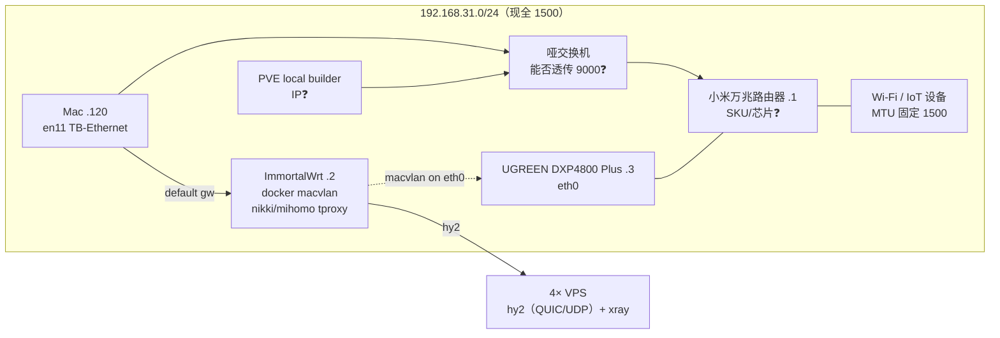

# 计划：内网 Jumbo MTU 与旁路由 VPN 传输效率研究（SDD）

## Context

**动机**：内网当前全链路 MTU 1500。大流量场景（Mac ↔ NAS 文件传输、备份、内网开发机间流量）与旁路由 VPN（ImmortalWrt/mihomo → hysteria2 QUIC → 4 台 VPS）的传输效率受包大小的天然限制：每字节负载要付出更多包头开销、更多中断/系统调用。研究启用超大 MTU（Jumbo Frames, 9000）能否提升这两条链路的效率。

**目标产物**：一份有数据支撑的研究报告（docs/），回答：

1. 内网启用 9000 MTU 是否**可行**（路径上每一跳的能力矩阵 + 短板定位）
2. 可行时**收益多少**（iperf3 实测对照），哪些场景值得
3. 旁路由 VPN 链路：QUIC over UDP 在大 MTU 下的吞吐/CPU 变化（hy2 是否受益）
4. （若可行）落地需要改哪些配置（nixfiles/路由器/NAS）、风险与回滚 —— **先给研究结果，可行时再出落地方案，经用户 approve 后才实施**

**执行方式**：Subagent-Driven Development —— 5 个研究 subagents，per-task review 循环，最终 adversarial review。**数据先行**：所有结论建立在完整收集的内网/VPN 数据之上。落地阶段（Task 6）拆成方案设计 → 用户 approve → 执行，方案未获批前不动任何网络配置。

## 已侦察事实（本会话已确认）

| 组件 | 位置/地址 | 关键事实 |
|---|---|---|
| 内网网段 | `192.168.31.0/24` | 主路由 `.1`，Mac 默认网关指向旁路由 `.2` |
| **主路由** | `192.168.31.1` | **小米万兆路由器**（具体 SKU/交换芯片待研究确认：固件是否支持 >1500 LAN MTU 是关键短板项） |
| 哑交换机 | Mac/PVE 上联必经节点 | **无管理面板**，无法配置，只能靠 `ping -D` 实测能否透传 9000 帧 |
| Mac (soraliu) | `192.168.31.120` | 主接口 **en11 = Thunderbolt Ethernet Slot 2**（有线，NIC 型号待查）；Wi-Fi en0 未启用；另有 USB 10/100/1000 (en7) |
| 旁路由 | `192.168.31.2` | **Docker 容器 ImmortalWrt 24.10.4**，跑在 NAS 上，macvlan 网络 `macnet`（`docker network create` **未显式设 MTU**，继承父接口） |
| 旁路由代理 | 容器内 | Nikki (Clash client) + **mihomo v1.19.27，tproxy 模式**，配置来自 `secrets/.config/clash/config-whitelist.enc.yaml`（sops 解密注入镜像） |
| NAS | `192.168.31.3` | **绿联 UGREEN DXP4800 Plus**（UGOS Pro，ssh `root@192.168.31.3`），eth0 为 macvlan 父接口（网卡规格待确认）；`macvlan-shim` @ `.250` 解决宿主↔容器互通（`docker/immortalwrt/scripts/nas-startup.sh`） |
| PVE local builder | 内网（IP 待收集） | 经哑交换机上联主路由，内网开发机间流量的重要参与方 |
| VPN 服务端 | 4 台 VPS | vpn_premium `103.112.1.197` / vpn_primary `45.202.255.241` / vpn_secondary `179.255.150.220` / vpn_hangzhou `47.98.202.4`；hy2 2.13.0 + xray 26.3.27（升级后），sysctl rmem/wmem 64MB 已就位 |
| 服务端配置源 | 本地仓库 `~/Github/nixfiles-wrapper/personal-k3s-ops/ansible/roles/vpn_server/` | 优先读仓库，避免 SSH VPS |
| 桌面客户端 | Mac 上 mihomo (pm2) | `home/modules/network/clash-meta/default.nix`，系统代理模式（tun 状态待确认；本机存在 utun7 @ `10.10.10.200`，归属待查） |
| 未知设备 | `192.168.31.4` | MAC `90:e3:ba:03:40:b3` 与 Mac 网卡（`...:d1`）同厂同批次 —— 疑似同款 TB 网卡的另一台设备（待识别） |

**注意**：Mac 的默认网关是旁路由 `.2`（全量流量走容器转发），这意味着 Mac↔NAS 的内网直连流量与 Mac→外网的 VPN 流量路径完全不同，MTU 影响链也不同，需分别评估。

## Global Constraints

- 全程中文报告（技术名词保留英文）；subagent 继承主会话 model 与 thinking（`AGENTS.md` 规约，**覆盖** SDD 默认的降档模型选择）
- **只读数据收集已获用户授权**：SSH NAS 只读、解密 clash 配置的 mtu/tun/网络字段（不输出密钥、不落盘明文）、读本地 `personal-k3s-ops` 仓库、SSH 4 台 VPS 只读。不碰任何 prod 集群（prod-do/prod-evoxt/b300 与本需求无关）
- 任何 MTU 变更实验与配置落地（`networksetup`/UGOS 设置/`ip link set`/docker network 重建）是独立 gate：**GATE-1 研究结果呈现 → 可行时 GATE-2 落地方案 approve → 确认低峰窗口后执行**，且限定 Mac en11 / NAS eth0 / macvlan 三处可逆操作，附即时回滚命令
- 研究产物先落 SDD workspace（git-ignored），最终报告 + 数据进 worktree 分支随 PR 提交；主工作区不残留
- PR squash merge，且仅在用户授权后合并

## Approach

### Step 0 — 数据全景清单（Phase 0，必须先完成）

**A. 本机 Mac**：`ifconfig -a` 全接口 MTU/速率、`system_profiler SPEthernetDataType`（en11 网卡型号与驱动能力）、`networksetup -getMTU en11` 及支持范围、utun7 归属（tailscale 残留 or mihomo tun？`lsof -i` + pm2 状态）、当前 mihomo 运行模式（系统代理端口/socks）

**B. 内网物理层**：ARP 全表 + MAC OUI 识别（有线 vs 无线设备清单）；**小米万兆路由器 SKU 确认**（交换芯片规格、固件是否提供 LAN MTU 设置项）；哑交换机 9000 帧透传能力（`ping -D -s` 实测）；PVE local builder 的 IP/网卡/接口 MTU；`.4` 同款网卡设备识别；`ping -D -s <size>` DF 探测 Mac↔主路由、Mac↔NAS path-MTU（确认现网交换能力上限）；Wi-Fi 设备占比（jumbo 豁免段）

**C. 旁路由容器**（SSH NAS 只读）：`docker network inspect macnet`（MTU 值）、容器内 `uci show network` / `ifconfig`（LAN/wan MTU）、防火墙中 MSS clamp 规则（`iptables-save`/`nft list ruleset` grep TCPMSS）、nikki/mihomo 配置中 tun/tproxy/mtu/quic 相关字段（解密授权后只 grep 网络/性能字段）；容器→VPS 的 `ping -M do` path-MTU 探测；NAS 侧：UGOS Pro 系统版本、网卡型号与链路速率、eth0 当前 MTU、Docker daemon MTU 配置

**D. VPN 数据面**（读本地 `personal-k3s-ops` 仓库 + 授权时解密）：hy2 配置模板（QUIC 参数）、sysctl（rmem/wmem）、4 台 VPS 的预期网络路径 MTU（`ansible` facts 或 ping 探测）、VPS 带宽套餐（问用户或实测基线）

**E. 流量基线**（只读、无变更）：iperf3 Mac↔NAS 当前吞吐；经旁路由 hy2 出口的代理吞吐 + mihomo/NAS CPU 占用；`tracepath`/`traceroute -I` 记录路径；当前 TCP 流的 MSS/包大小样本（可从 ss 或抓包统计）

### SDD subagent 分工（5 研究 + 1 落地）

| # | Agent（name@kind） | 角色 | 产出 |
|---|---|---|---|
| 1 | `mtu-lan`@scout | 内网物理拓扑与 MTU 能力矩阵收集（Step 0-A/B + E 部分） | 设备×MTU 能力矩阵 + path-MTU 探测数据 |
| 2 | `mtu-vpn`@scout | 旁路由容器与 VPN 数据面收集（Step 0-C/D） | 容器/服务端 MTU 相关配置事实清单 + 探测数据 |
| 3 | `mtu-jumbo`@scout（research） | Jumbo frame 技术研究：macOS/UGOS/macvlan/OpenWrt 各层支持细节、小米路由器固件 9000 支持现状、哑交换机转发能力、PMTUD 黑洞已知坑、Wi-Fi 共存问题 | 技术可行性研究报告（带引用） |
| 4 | `mtu-quic`@scout（research） | hy2/QUIC/mihomo MTU 行为：DPLPMTUD（RFC 8899）升包机制、QUIC 大包 vs 中间设备丢包、tproxy 下 MSS 处理、QUIC buffer/参数调优点 | VPN 侧收益机理分析与调优清单 |
| 5 | `mtu-bench`@scout | 整合 1-4 数据，设计基准测试矩阵（场景×MTU 变量×指标），先执行**只读基线**与 DF 探测 | 测试设计文档 + 基线数据表 |
| 6a | `mtu-plan`@worker | **GATE-1 通过且结论可行后**：设计落地方案文档（逐项配置 diff、执行顺序、回滚步骤、实验数据缺口补测计划） | 落地方案文档（待用户 approve） |
| 6b | `mtu-deploy`@worker | **GATE-2（方案 approve）后**：执行落地（nixfiles PR + NAS/UGOS/Mac 运行时配置）+ 回归验证 | 配置变更 diff（nixfiles worktree PR）+ 落地验证数据 |

Task 1/2 并行（不同数据源）；3/4 并行（纯研究，web + 文档）；5 依赖 1-4；6a 依赖 GATE-1（研究结果可行）；6b 依赖 GATE-2（方案 approve）。父会话保留整合：基于全部报告合成最终报告。per-task review 由 reviewer 承担（数据完整性 + 结论可验证性 + 无密钥泄漏），SDD fix loop 照常。

> [!NOTE]
> SDD 标准流程面向"写代码"任务；本计划研究任务的映射为：**实现=报告/数据文件（commit 到 worktree 分支）**，**测试=验收 checklist（数据文件存在、字段齐全、命令可复现）**，**review=专项审查**。

### 基准测试矩阵（Task 5 设计，供审阅）

| 维度 | 内容 |
|---|---|
| 链路 | Mac↔NAS（内网直连）／Mac→hy2 出口（经旁路由）／旁路由→VPS |
| MTU 档位 | 1500（基线）／9000（实验档，gate 后）／中间档（如 4000，排查短板用） |
| 指标 | iperf3 单/多流吞吐、CPU 占用（mihomo/NAS/Mac）、retransmits、QUIC 包大小样本（tcpdump 统计） |
| 安全网 | 实验前 `ping -D` 逐跳探测确认；每步实验后立即恢复原 MTU 并复测连通；终止条件=任何设备失联>60s |

### 决策标准（写进最终报告的结论框架）

- **内网**：全链（网卡+主路由+哑交换机+所有参与传输的设备）≥9000 → 给出落地步骤与配置 diff，进 Task 6a 方案设计（待用户 approve）；存在硬件短板 → 明确“当前不可行” + 换硬件/局部子网方案（如独立 jumbo 链路、VLAN 隔离）的代价对比，Task 6a 仅覆盖用户认可的低成本项
- **VPN**：吞吐提升 <5% 或公网中间设备丢大 UDP 包导致负收益 → 结论“不值得”，仅保留 QUIC buffer 建议等低成本项；CPU 显著下降且吞吐无回退 → 给出配置项（macvlan/nikki/kernel buffer）进 Task 6a

## Files to modify / 产出

| 文件 | 动作 |
|---|---|
| `docs/network/jumbo-mtu-research.md` | 新增：最终研究报告（结论矩阵、证据、落地建议） |
| `docs/network/data/*.txt|*.csv` | 新增：原始探测/iperf3 数据（供复核） |
| `docker/immortalwrt/Justfile` / `scripts/nas-startup.sh` / `default.nix` | （Task 6b，视 approved 方案）macvlan 组网与 shim 的 MTU 相关变更 |
| `home/modules/network/clash-meta/default.nix` 及 `secrets/.config/clash/config-whitelist.enc.yaml` | （Task 6b，视 approved 方案）桌面/旁路由 mihomo 的 QUIC/MTU 相关字段 |
| `~/Github/nixfiles-wrapper/personal-k3s-ops`（独立仓库） | （Task 6b，视 approved 方案）hy2 服务端 QUIC 参数 —— 属另仓库，另走该仓库的 worktree+PR 流程 |
| NAS/Mac 运行时操作 | 不入 git 的部分（UGOS 界面设置、Mac `networksetup`）→ 写成报告内 runbook 章节，附每步验证命令 |

## Reuse（已存在的情报/资产）

- `plan/hysteria2-upgrade.md` —— VPN 组件现状普查表（VPS 清单、版本、mihomo 能力），Task 2/4 直读复用
- `docker/immortalwrt/{Dockerfile,default.nix,Justfile,scripts/nas-startup.sh}` —— 旁路由构建/组网全景（macvlan、shim、网络创建命令）
- `secrets/bin/x86_64-linux/nas/README.md` —— NAS SSH 与初始化方式
- `~/Github/nixfiles-wrapper/personal-k3s-ops/ansible/roles/vpn_server/` —— 服务端配置与 sysctl 真源（免 SSH）
- `home/modules/network/clash-meta/default.nix` —— 桌面端 mihomo 运行方式

## Steps

- [ ] 0. 执行前置：`git worktree add -b research/jumbo-mtu ~/.pi/worktree/nixfiles/research-jumbo-mtu origin/main`；`sdd-workspace` 建 SDD workspace + ledger；本 plan 文件 mv 进 worktree
- [ ] 1. Task 1 `mtu-lan`：dispatch → 报告（设备能力矩阵 + 探测数据）→ review → fix loop → complete
- [ ] 2. Task 2 `mtu-vpn`（与 1 并行）：dispatch → 报告（容器+服务端事实清单）→ review → complete
- [ ] 3. Task 3 `mtu-jumbo` + Task 4 `mtu-quic`（与 1/2 并行调研，引用其报告路径需等 1/2 数据就绪后校对）：技术综述报告 × 2 → 各自 review
- [ ] 4. Task 5 `mtu-bench`：测试矩阵设计 + 只读基线执行 → review
- [ ] 5. 父会话合成研究结果 → adversarial-reviewer 做整体审查（证据链完整性、结论与数据一致性）→ repair
- [ ] 6. **GATE-1**：向用户呈现研究结果（结论矩阵 + 数据证据 + 收益预期）；结论可行时请求批准短时 MTU 对照实验（可逆）补齐实测收益数据并追加进报告
- [ ] 7. Task 6a `mtu-plan`（结论可行时）：落地方案文档（diff/执行顺序/回滚）→ review
- [ ] 8. **GATE-2**：落地方案呈现用户 approve
- [ ] 9. Task 6b `mtu-deploy`（方案 approve 后）：执行落地 + 回归测试 → review → PR（nixfiles；涉及 personal-k3s-ops 时另开该仓库 PR）
- [ ] 10. 终审复核 → squash 合并（用户授权后）→ 删 worktree

## Verification

- 每个 task 的报告有验收 checklist：数据项覆盖 Step 0 对应条目、每条结论附**可复现命令**与原始输出、报告无密钥/敏感值
- Task review 逐项对照数据清单（缺项=spec fail 进 fix loop）
- 最终报告结论矩阵：每个"可行/不可行/收益 X%"都指向数据文件的具体段落
- 实验数据可复核：报告附实验时间、环境快照（MTU 设置回滚前后 `ifconfig` 输出）
- Task 6b 落地后的回归验证：全设备连通性（含 Wi-Fi 设备访问有线大文件场景）、iperf3 复测收益达标、`just reset` 回滚预案演练
- 结束前 `git status` 确认主工作区无残留、workspace 清理

## Risks

| 风险 | 缓解 |
|---|---|
| MTU 实验造成内网中断（含走旁路由的默认路由） | 实验只动可逆三处（Mac en11/NAS eth0/macvlan recreate）；每步带回滚命令；gate 授权 + 低峰窗口；ImmortalWrt 容器 rollback 预案（`just reset`） |
| 主路由是最终短板（小米固件可能无 LAN MTU 设置项，万兆交换芯片支持但固件不开） | Phase 0 深挖小米万兆路由器固件能力（社区/固件分析）；结论为"当前不可行"也是合格产出 |
| 哑交换机无法 9000 透传 | DF 探测直接验证；不可行则结论给出绕行方案（Mac/NAS 直连主路由万兆口等拓扑选项） |
| PMTUD 黑洞：9000 与 1500 设备共存时 NDP/ICMP 被丢 | 研究覆盖 MSS clamp 与隔离方案；实验含混合 MTU 场景验证 |
| hy2 大 UDP 包在公网被中间设备丢弃/限速，QUIC DPLPMTUD 收敛慢 | QUIC 侧实验对照 1500/9000 双档；负收益即止 |
| 侦察命令与真实输出过大淹没 subagent 上下文 | 全部经 ctx 工具（context-mode）收敛后落盘数据文件 |
