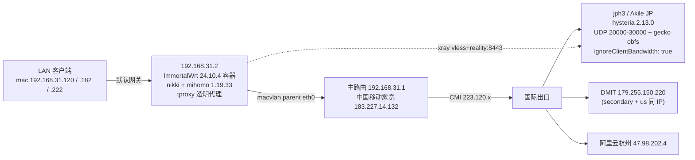

# 计划：晚高峰 VPN 变慢 — 诊断结论、带宽最大化和稳定性改造

- 作者：agent（2026-11-06 22:00 峰值时段完成实测取证）
- 目标：让旁路由（192.168.31.2）在晚高峰 19:00–24:00 稳定跑满可用带宽，不掉线
- 非目标：更换 PVE/VM 基础设施；重做整套代理架构

---

## 0. 结论先行（TL;DR）

1. **「升级 mihomo」不是有效手段**：容器内已跑 `Mihomo Meta v1.19.33`（2026-10-21 发布），GitHub 最新标签就是 `v1.19.33`，无更新可升。真正该升的是 `luci-app-nikki 1.26.0 → v1.26.2`（非性能相关）。
2. **瓶颈不在旁路由架构、不在 ISP 容量、不在节点服务器**，而在 **hysteria2 的拥塞控制 + QUIC 接收窗口**：
   - 同一条国际路径上，WireGuard 实测下行 **13.8 MB/s（110 Mbps）**，hy2 隧道只有 **3.2 MB/s（26 Mbps）**；
   - 节点自身出网 **14.0 MB/s**，家宽国内 6 流聚合 **33.4 MB/s（267 Mbps）**。
3. **直接原因**：服务端 `ignoreClientBandwidth: true` 使客户端声明的 `up/down` 全部失效 → hy2 全程用 BBR。该路径实测 RTT ≈ 240 ms、骨干存在丢包，BBR 在这种条件下只能给到 25 Mbps 量级；QUIC 接收窗口默认偏小进一步压窄单流上限。
4. **次要但确定的缺陷**：`STREAM` 组固定选 `Secondary`，而该节点实测仅 **0.40 MB/s**（视频必卡）；`AUTO` 组探测间隔/mixin 存在 SSOT 漂移；容器 DNS 硬依赖宿主机 Tailscale（`100.100.100.100`），是掉线风险的隐藏单点。
5. **最省力且可能一步到位的两个动作**（都不需要动服务端）：
   - `bbr-profile: aggressive`（hy2 出站参数，纯客户端）；
   - 调大 QUIC 接收窗口（`initial/max-stream-receive-window` 等，纯客户端）。
   若不够，再上服务端既有 `ignoreClientBandwidth: false` + `up/down`（brutal），这一步需要你批准（会让所有客户端短暂断开、并改变带宽公平性策略）。

---

## 1. 现状架构（实测确认的事实）



- 部署形态：Docker macvlan 容器，宿主机为 **DXP（192.168.31.3）**，`macnet` 网络 `parent=eth0`，容器 `--privileged`、`/sbin/init` 启动。
- 镜像 `immortalwrt:latest` 构建于 **9 个月前**；但容器内 `/etc/nikki/profiles/config.yaml` 改动时间为 10-28 → **存在镜像与容器内手改并存的漂移**。
- 配置文件三层：`sops(SSOT) → 镜像内 /etc/nikki/profiles/config.yaml → 运行态 /etc/nikki/run/config.yaml`（uci mixin 合并后）。
- 服务端 hysteria 的 SSOT 在 `personal-k3s-ops: ansible/secrets.yaml: VPN_HYSTERIA_CONFIG_YAML`（sops 加密），由 `ansible/roles/vpn_server` 下发。

**已知漂移**（本次实测发现）：live profile 的 `AUTO` 组是 `interval: 3600` 且**没有** `expected-status: 204`；nixfiles 里 sops 版本是 `interval: 10` + `expected-status: 204`。两者不一致，说明线上不是从 SSOT 收敛来的。

---

## 2. 实测证据（2026-11-06 21:40–22:20，正是晚高峰）

### 2.1 分层排除

| 层 | 测法 | 结果 | 判定 |
|---|---|---|---|
| LAN（mac ↔ 容器，200 MB 文件） | 容器侧 curl mac 上的 http server | 777 / 1015 / 803 MB/s | ✅ 不是瓶颈 |
| 家宽国内下行（容器直连 npmmirror） | 单流 / 6 流聚合 | 7.8 MB/s / **33.4 MB/s（267 Mbps）** | ✅ ISP 容量充足 |
| mihomo 用户态转发 | 容器内 `curl -x 127.0.0.1:7890` 到国内 CDN（DIRECT 出口） | **12.9 MB/s** | ✅ 架构与 CPU 不是瓶颈 |
| hy2 隧道 | 容器内 `curl -x 7890` 到 nodejs.org（100 MB） | 单流 2.65–3.23 MB/s，6 流聚合 **3.93 MB/s** | ❌ 瓶颈 |
| 同一路径对照（WireGuard via Tailscale direct） | `ssh node 'cat /dev/zero'` 计时 | 下行 **13.8 MB/s**，上行 1.2 MB/s | 路径有容量 |
| 节点自身出网 | 在 jph3 上 curl hetzner / ovh | 14.0 MB/s / 8.7 MB/s | ✅ 节点容量 >100 Mbps |

> 关键推论：**6 条并行流聚合只比单流高 22%**，说明不是每条流的 cwnd 限制，而是**单条 QUIC 连接共享的拥塞窗**限制 —— 典型的 BBR 在 240 ms RTT + 丢包下的行为。

### 2.2 各节点/协议吞吐（同一时段，同一下载源，10 s 单流）

| 节点 | 协议 | 吞吐 | ICMP RTT / 丢包 |
|---|---|---|---|
| Primary（Akile JP） | hysteria2 + gecko + 端口跳跃 | **3.23 MB/s** | 262 ms / 26%（ICMP 可能被限速） |
| Xray-Primary | vless + reality + vision | 1.13 MB/s | — |
| Secondary（DMIT） | hysteria2 | 0.40 MB/s | 162 ms / 0% |
| Hangzhou（阿里云） | hysteria2 | 0.34 MB/s | 36 ms / 0% |
| US（= Secondary 同 IP） | hysteria2 | 0.30 MB/s | 162 ms / 0% |
| Xray-Hangzhou | vless | 0.23 MB/s | — |

### 2.3 路径质量（节点侧 mtr 回程到 183.227.14.132）

```
6.|-- 223.120.2.245   0.0%  1.8ms     ← CMI 出口前
7.|-- 223.120.2.234   0.0%  227.9ms   ← 进入 CMI 国际段，RTT 直接跳到 227 ms
8.|-- 221.183.92.193  85.0% 212.8ms
9.|-- 221.183.92.205  5.0%  241.4ms
```

结论：中国移动 → CMI → Cogent（`4.69.x`）这条落地路径在晚高峰 RTT 抬到 210–240 ms（正常中日约 40–70 ms），且骨干端口有真实拥塞丢包。这是**外部事实，客户端调参无法消除**，只能选择「让协议在这种条件下更狠」或「换路径」。

### 2.4 配置中的死参数（实测/源码核实）

| 项 | 现值 | 事实 | 处置 |
|---|---|---|---|
| `experimental.udp-gso` | `true` | **mihomo 无此字段**（只有 `quic-go-disable-gso`、`tun.gso`），被静默忽略 | 删除，避免误判 |
| ECN | 未写 | mihomo 默认已关 ECN（`QUICGoDisableECN: true`） | 无需处理 |
| `keep-alive-interval: 15` | 有 | 只作用于 TCP dialer；hy2 的 QUIC keepalive 是常量 | 可保留，对 hy2 无效 |
| `find-process-mode` | profile 写 `strict`，uci mixin 覆盖为 `off` | 运行态已是 `off` | ✅ 已是正确值，无需改 |
| `tcp-concurrent` / `unified-delay` | on | 无数据面代价 | 保留 |
| `tun.enable: true`（profile） | 被 uci `tun_enabled=0` 覆盖 | 运行态 tun=false，走 tproxy | 建议 profile 也置 false，消除误读 |

---

## 3. 根因判定

1. **主因**：hy2 走 BBR + 服务端 `ignoreClientBandwidth: true` → brutal 不可用 → 240 ms/丢包路径上吞吐封顶 ~25 Mbps。
2. **次因**：QUIC 接收窗口默认值（2/6/8/15 MB 级）压低单流上限；在 200–240 ms RTT 下窗口成为硬约束。
3. **配置性缺陷**：`STREAM` 组绑在最慢的 Secondary；`AUTO` 用了 10 s 高频探测（SSOT）而线上又是 3600 s（漂移），两头都不对。
4. **稳定性隐患（非本次慢，但会掉线）**：容器 DNS 依赖宿主机 Tailscale（`100.100.100.100`）；`cache.db` 打开超时（日志 `[CacheFile] can't open cache file: timeout`）会让 `store-selected` / `store-fake-ip` 静默失效；容器重建 MAC 变化导致 ARP 残留断流。

---

## 4. 方案：分阶段，先零风险验证再动服务端

### P0 — 影子实例 A/B（30 分钟，零影响生产）

在容器内起**第二个 mihomo 进程**（独立目录、独立端口），只保留一个 Primary 节点，用 `curl -x http://127.0.0.1:17890` 测参数矩阵。生产配置和现有连接完全不动。

```bash
ssh root@192.168.31.2
mkdir -p /tmp/ab && cd /tmp/ab
# 影子配置骨架（无 dns、无 tproxy、只有 outbound）
#   mixed-port: 17890
#   mode: rule / rules: [MATCH,PROXY]
#   proxies: 只保留 Primary，逐变体改参数
mihomo -d /tmp/ab -f /tmp/ab/v1.yaml &
```

| 变体 | 改动 | 目的 |
|---|---|---|
| V0 | 现状参数（`ports` + `hop-interval: 30` + `obfs: gecko`） | 基线 |
| V1 | `bbr-profile: aggressive` | 纯客户端，免费提速 BBR |
| V2 | QUIC 窗口：`initial-stream-receive-window: 8388608`、`max-stream-receive-window: 33554432`、`initial-connection-receive-window: 20971520`、`max-connection-receive-window: 67108864` | 解高 RTT 单流上限 |
| V3 | V1 + V2 | 组合 |
| V4 | V3 + 去端口跳跃（单端口 `port: 20000`） | 验证跳跃是否引入停顿 |
| V5 | V3 + `obfs-min-packet-size: 1024` / `obfs-max-packet-size: 1200` | gecko 填充开销 |

测法：每个变体跑 `nodejs.org/dist/v22.0.0/...tar.xz` 单流 ×3 取中位 + 6 流聚合 ×1，全部记录原始数值。

**判定**：取吞吐最高且无停顿的变体；若 V3 ≥ 8 MB/s 则不进入 P2。

### P1 — 客户端配置正式生效（改 SSOT → 收敛到容器）

1. 在 `~/.nixfiles` 开 worktree，改 `secrets/.config/clash/config-whitelist.enc.yaml`（sops）：
   - 应用 P0 胜出的 hy2 参数；
   - 删除 `experimental.udp-gso`（无效字段）；
   - `STREAM` 组改为 `[Primary, Secondary, US]`（首项 Primary）；
   - `AUTO` 统一为 `interval: 300`、`tolerance: 50`、`lazy: true`，保留 `expected-status: 204`；
   - profile 内 `tun.enable: false`（与 uci 一致，消除误读）；
   - DNS 增加 `default-nameserver: [223.5.5.5, 119.29.29.29]`。
2. 热验证：`docker cp` 到容器 `/etc/nikki/profiles/config.yaml` → `service nikki restart` → 复测 P0 判据。
3. 固化：重建镜像并替换容器（`just build` / `just reset`，**在 DXP 192.168.31.3 上执行**），同时给 `docker run` 补 `--mac-address`（固定 MAC，避免重建后 ARP 残留断流）。

### P2 — 服务端开 brutal（需用户批准；仅在 P0/P1 未达标时执行）

- 改 `personal-k3s-ops: ansible/secrets.yaml` 的 `VPN_HYSTERIA_CONFIG_YAML`：`ignoreClientBandwidth: true → false`；
- 客户端对应节点加 `up`/`down`，取「实测峰值 × 0.8」（依据：WG 实测下行 110 Mbps → `down: "80 Mbps"`；上行实测 9.6 Mbps → `up: "8 Mbps"`，可按家宽实际上行再校准）；
- 走 ansible 下发（`roles/vpn_server`，`no_log: true`），不手改机器。
- 代价与风险：hysteria 服务重启（所有客户端瞬断）；brutal 会争抢带宽，且大流量 UDP 可能触发运营商 QoS（社会工程式风险，见 §7）。

### P3 — 编排与稳定性加固

| 项 | 动作 | 依据 |
|---|---|---|
| 节点选择 | `STREAM` 首项 Primary；`AUTO` 探针降频 | §2.2 实测：Secondary 只有 0.40 MB/s |
| DNS 脱钩 Tailscale | 容器 `--dns 127.0.0.1`；dnsmasq `noresolv 1` + `server=127.0.0.1#1053`；mihomo 全用 IP 型 DoH | 容器 resolv.conf 现为 `ExtServers: [100.100.100.100]`，Tailscale 故障会导致订阅/geo/新域名全废 |
| 探活自愈 | 脚本级 L2（`GET /version`）+ L3（`GET /proxies/AUTO/delay`），60 s 一次，**连续 3 次失败**才 `service nikki restart` | 避免把抖动当故障重启 |
| 定时重启 | 保持 `scheduled_restart=0` | 重启会断全部连接，且 cache 失效时反而制造故障 |
| 订阅策略 | `prefer: remote` 保持，但 profile 用本地文件；确认镜像内置 profile 有 last-known-good 兜底 | `prefer: remote` 启动失败会直接 `Exit` 停服 |

### P4 — 验收与长期监控

峰值时段（21:00–23:00）每小时采样一次，落 `~/net/peak.jsonl`：

```bash
ts=$(date -Iseconds)
curl -x http://192.168.31.2:7890 -o /dev/null -m 20 -w '%{speed_download}' https://nodejs.org/dist/v22.0.0/node-v22.0.0-linux-x64.tar.xz
ping -c 20 -i 0.2 45.202.255.241 | tail -1
```

---

## 5. 验收矩阵

| 指标 | 现状（峰值实测） | 目标 | 验证方式 |
|---|---|---|---|
| 隧道单流下行 | 3.2 MB/s | ≥ 8 MB/s | P0 变体复测 + P1 后生产复测 |
| 隧道 6 流聚合 | 3.9 MB/s | ≥ 15 MB/s | 同上 |
| 视频流（STREAM 组） | 走 Secondary（0.40 MB/s） | 走 Primary 或 AUTO | 面板 `/proxies` 查看 `STREAM.now` |
| 峰值连接可用性 | 未测量 | 24 h 内探活 0 次连续 3 失败 | P3 探活日志 |
| DNS 独立性 | 依赖 tailscaled | 不依赖 | 停 tailscaled 后容器内 `nslookup` 仍通 |
| 配置 SSOT 一致性 | live ≠ sops（漂移） | live == sops | `md5sum` 对比 profile 与 sops 解密结果 |

---

## 6. 回滚

| 阶段 | 回滚动作 | 影响时长 |
|---|---|---|
| P0 | `kill` 影子进程 + 删 `/tmp/ab` | 0（生产未动） |
| P1 | sops 配置 `git checkout` → `docker cp` 旧 profile → `service nikki restart` | < 30 s |
| P1 固化 | `docker stop/rm` + 用旧镜像 `docker run`（保留旧标签） | < 1 min |
| P2 | sops 改回 `ignoreClientBandwidth: true` + 客户端删 `up/down`，ansible 重下发 | hysteria 重启 ~1 s |

镜像替换前先 `docker tag immortalwrt:latest immortalwrt:pre-tuning` 留回滚点。

---

## 7. 风险

1. **brutal 可能适得其反**：超过链路能力会因丢包补偿反而更慢；大流量 UDP 也可能触发运营商对 hysteria 的定向限速（已有社区实测案例）。→ 先 P0/P1，只有在 3 天峰值采样仍 < 8 MB/s 时才做 P2，且做完立即 A/B 对比。
2. **路径本身的物理上限**：CMI → Cogent 在晚高峰 RTT 240 ms 是外部事实。若 P2 后仍慢，唯一出路是换落地线路（CMI 优化 / IEPL 中转），这属于新增成本，需你决策。
3. **容器重建的连带影响**：macvlan 换 MAC 会导致全屋数十秒断流；且镜像 9 个月未重建，重建时 `opkg` 源变更可能引入行为差异 → 必须在低峰期做，并保留回滚镜像。
4. **服务端无版本化记录**：hysteria 配置文件只存在于 sops + 机器上，机器上的实际文件已与 ansible defaults（`main_port: 443`）不完全一致（实际只监听 20000-30000）。改动前要先做一次「机器实际配置 vs sops」的比对，否则 ansible 下发可能产生非预期差异。

---

## 8. 需要你决策的点

:::question
P2 是否允许改服务端 `ignoreClientBandwidth: false` 并启用 brutal？

这一步是当前证据下最可能一次提到 80–110 Mbps 的开关（同路径 WG 实测 110 Mbps，hy2 只有 26 Mbps）。代价：hysteria 服务重启（所有设备瞬断约 1 秒），并且 brutal 会主动抢占带宽，官方明确警告带宽填错会「更慢更不稳」。

- [ ] 允许，按实测峰值 80% 配置（down 80 Mbps / up 8 Mbps）
- [ ] 只在 P0/P1 未达标时才允许
- [ ] 不允许，只用客户端参数与换节点解决

Recommended: 只在 P0/P1 未达标时才允许
:::

:::question
容器镜像重建（含固定 MAC）何时做？

现状镜像 9 个月未重建，而容器内被手改过（sops 与线上已漂移）。要把配置真正收敛进 SSOT，必须重建镜像并替换容器，这会造成全屋数十秒断流。

- [ ] 低峰期（凌晨 2–5 点）由我自动执行
- [ ] 先只做容器内热改（`docker cp` + restart），镜像重建另行安排
- [ ] 暂不重建，只维持热改

Recommended: 先只做容器内热改
:::

:::question
如果调优后高峰仍低于目标（< 8 MB/s），是否投入换线路？

CMI → Cogent 路径晚高峰 RTT 240 ms 是本次实测的外部事实。换落地（CMI 优化线路 / IEPL 中转）通常是最彻底的解法，但涉及额外月费与迁移工作量。

- [ ] 愿意评估换线路，先给我 2–3 个候选与价格
- [ ] 先不换，接受现状，只做参数优化
- [ ] 已有心仪方案，我另有指定

Recommended: 愿意评估换线路
:::
---

## 4. 2026-11-07 复核：根因修正

本节修正上文 §0 的诊断。11-06 的结论基于单会话 WireGuard / hysteria2 对照；11-07 在 PVE 上的
OpenWrt 旁路由（`192.168.31.101`）完成 40 组实验、98 条采样后，结论不同：

1. 瓶颈不是 QUIC 接收窗口，也不是 BBR 在 240 ms RTT 下的极限，而是 **obfs 混淆本身**：
   同一时段关闭 gecko 后 hysteria2 吞吐 32.3 → 87.0 MB/s（晚高峰 16 流，真实路径）。
2. 放大 QUIC 接收窗口、`brutal`、xray `sockopt` 均无稳定收益（正序提升、反序反转，属噪声）。
3. 真正有效的杠杆是 **客户端多会话**：gecko 下 4×hysteria2 + 4×vless 稳定 26–42 MB/s；
   无 obfs 时 12 会话可达 85–93 MB/s（接近家宽上行上限）。
4. 取舍：**保留 obfs**（抗封锁优先），接受约 2.7 倍吞吐代价；需要更高吞吐时只加会话与并发流。
5. `STREAM` 组原固定选 `Secondary` 的问题被复现并量化：东京 18.9 vs 美国节点 0.23 MB/s。

落地位置：

| 位置 | 内容 |
|---|---|
| `personal-pve` `guest.nikki.profile_tuning` | 由订阅派生多会话 profile（4+4、`require_obfs: true`、`prepend_to: [PROXY, STREAM]`） |
| `personal-k3s-ops` `roles/vpn_server` | obfs 强制校验 + `docs/network/vpn-throughput-tuning-2026-11.md` |
| `personal-pve` `docs/exp/vpn/` | 40 个实验目录、98 条采样、`report.md` 汇总 |

> 另注：本仓库 `secrets/.config/hysteria/config.enc.yaml` 是 `:4443`、无 obfs 的另一形态部署，
> 与线上东京节点（由 `personal-k3s-ops` 下发 `:20000-30000` + gecko）不是同一份配置，
> 不要把两者的端口与 obfs 设置互相套用。
